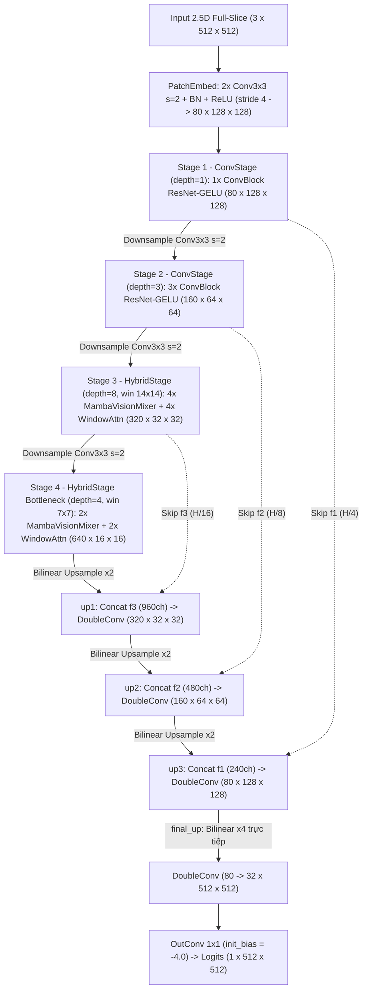
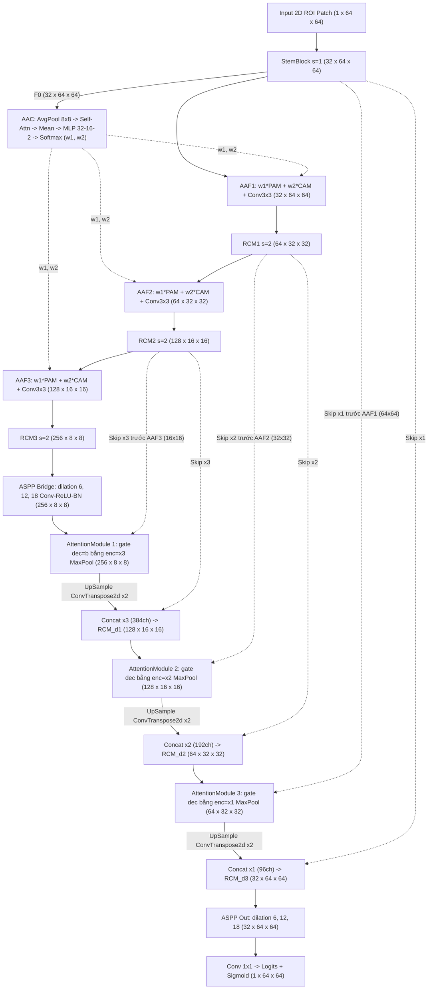
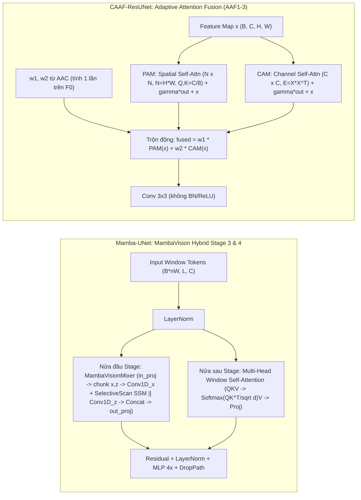

# So sánh chi tiết hai kiến trúc: `Mamba-UNet` vs. `CAAF-ResUNet`

Tài liệu đối chiếu trực tiếp từ mã nguồn thực tế của hai dự án:
- **`Mamba-UNet`**: `SOURCES/mamba_unet/` (`model.py`, `backbone/mamba_vision.py`, `decoder.py`, `blocks.py`, `losses.py`, `trainer.py`, `configs/default.yaml`, các báo cáo `runs/`).
- **`CAAF-ResUNet`**: `MV_CAAFNet/src/` (`models/caaf_resunet.py`, `blocks.py`, `aspp.py`, `attention.py`, `aac.py`, `aaf.py`, `losses/`, `train.py`, `configs/base.yaml`).

---

## 1. Sơ đồ kiến trúc tổng thể

### 1.1 Kiến trúc `Mamba-UNet` (`MambaVision-T` Encoder + `UNetDecoder`)

> Đầu vào: lát cắt toàn phổi **2.5D** `(B, 3, 512, 512)` (3 lát liên tiếp `[z-1, z, z+1]`, có lung mask). Tổng **~36,0M tham số** (~31,1M Encoder pretrained ImageNet-1K + ~4,9M Decoder).

> [!WARNING]
> **Điểm nghẽn độ phân giải ở `Mamba-UNet`**: `PatchEmbed` giảm kích thước ngay xuống **`H/4`** (`512 → 128`) ngay từ lớp đầu tiên và **không có skip connection ở `H/1` hay `H/2`**. Ở cuối decoder, `final_up` phải nội suy tuyến tính phóng thẳng **`×4`** từ `128 → 512`. Nốt phổi siêu nhỏ `3–5 mm` (chỉ vài pixel ở `512×512`) dễ bị nhòe/mất biên trước khi tới Stage 1.

---

### 1.2 Kiến trúc `CAAF-ResUNet` (`ResUNet++` + `AAC/AAF` + `ASPP`)

> Đầu vào: patch ROI quanh nốt **2D** `(B, 1, 64, 64)` (không lung mask). Tổng **~6,6M tham số** (train từ đầu, gọn hơn ~5,5×).

---

### 1.3 So sánh khối trộn đặc trưng lõi (Core Mixing Block)

---

## 2. Bảng đối chiếu toàn diện theo 16 tiêu chí

| # | Tiêu chí | `Mamba-UNet` (`SOURCES/mamba_unet`) | `CAAF-ResUNet` (`MV_CAAFNet`) |
|---|---|---|---|
| 1 | **Bản chất bài toán** | **Phát hiện + Phân đoạn toàn lát cắt (Full-slice 2.5D)**, có cả lát âm tính không chứa u | **Phân đoạn tinh viền trên vùng ROI đã định vị sẵn (2D Patch)**, 100% patch đều chứa u |
| 2 | **Đầu vào (Input)** | `(B, 3, 512, 512)` hoặc `(B, 3, 448, 448)` — ghép 3 lát kề `[z-1, z, z+1]` | `(B, 1, 64, 64)` — 1 lát 2D duy nhất quanh trọng tâm 3D của nốt |
| 3 | **Tiền xử lý CT** | Lung Mask = `True`; cửa sổ `[-1350, +150] HU`; **lượng tử hóa 25 HU**; lọc nốt $\ge 5$–$20\text{ mm}^2$; giữ 25–35% lát âm tính; resample 1 mm | **Không** Lung Mask; cắt đáy `-1000 HU`, cửa sổ `[-1000, 400] HU`; **không** lượng tử hóa; giữ spacing gốc (`resample_mm: null`) |
| 4 | **Quy mô tham số** | **~36,0M** (~31,1M Encoder + ~4,9M Decoder; file fp16 ~68,8 MB) | **~6,6M** (gọn hơn ~5,5×) |
| 5 | **Pretrained / Khởi tạo** | **Pretrained ImageNet-1K** (NVlabs MambaVision-T) + đóng băng 3–5 epoch đầu | **Train từ đầu (Scratch)** bằng khởi tạo Kaiming mặc định PyTorch |
| 6 | **Các tầng Encoder & Kênh** | 4 tầng ở `H/4, H/8, H/16, H/32` — kênh `[80, 160, 320, 640]`, depths `[1, 3, 8, 4]` | 4 tầng ở `H/1, H/2, H/4, H/8` — kênh `[32, 64, 128, 256]` (mỗi tầng 1 RCM) |
| 7 | **Cơ chế học ngữ cảnh xa** | **Hybrid tuần tự**: Conv (Stage 1–2) → **1D Selective Scan SSM** (nửa đầu Stage 3–4) → **Window Self-Attention** (nửa sau Stage 3–4) | **Song song đa tầng**: **PAM** (toàn cục không gian) + **CAM** (tương quan kênh) trộn động bởi **AAC** (Self-Attention trên `8×8`) |
| 8 | **Độ phức tạp bộ nhớ Attention** | **$O(N)$** cho Mamba SSM và **$O(N \cdot W^2)$** cho Window Attention (cửa sổ `14×14`, `7×7`) → chạy tốt ở `512×512` | **$O((HW)^2)$** cho PAM ở `64×64` ($N=4096 \Rightarrow$ ~64 MB/ảnh); **không thể** mở rộng trực tiếp lên `512×512` (sẽ OOM) |
| 9 | **Bottleneck (Cầu nối)** | Stage 4 Mamba+Attention (`640 × H/32 × W/32`), không có ASPP | **ASPP** đa tỉ lệ dilation `(6, 12, 18)` ở `256 × 8 × 8` |
| 10 | **Decoder & Attention Gate** | `UNetDecoder` đối xứng thuần túy (`DoubleConv`), **không** có Attention Gate | Decoder kiểu **ResUNet++**: có **`AttentionModule`** ở cả 3 tầng + **`ResidualConvModule`** pre-activation |
| 11 | **Cơ chế Upsampling** | `nn.Upsample(mode="bilinear")` (×2 ở `up1–3`, **×4 một phát** ở `final_up`) | `ConvTranspose2d(ch → ch, k=2, s=2)` học được ở từng bậc (×2 ba lần) |
| 12 | **Skip Connections** | 3 đường ở `H/4, H/8, H/16` (**thiếu `H/1` và `H/2`**) | 3 đường ở **`H/1 (64), H/2 (32), H/4 (16)`**, lấy **trước AAF** (`x1, x2, x3`) |
| 13 | **Lớp đầu ra (Head)** | `DoubleConv(80→32)` → `OutConv 1×1` với **`init_bias = -4.0`** (chống mất cân bằng nền/u 512×512) | **`ASPP_out(32→32)`** → `Conv 1×1` (bias mặc định) |
| 14 | **Hàm mất mát (Loss)** | Loss vùng & chống mất cân bằng: `Dice+BCE` (`batch_dice=True`, `pos_weight=1.5..4.0`), `Tversky`, `Focal-Tversky`, `Focal` | **Boundary-Aware Loss (BAL)**: `Per-sample Soft Dice + λ · BoundaryLoss` (**Sobel**, **Laplacian**, **Hausdorff EDT**) |
| 15 | **Kỹ thuật huấn luyện** | Transfer learning tinh chỉnh kỹ: AdamW **4 nhóm** (backbone LR `0.1×`, no-decay cho norm/`A_log`), CosineLR, **EMA `0.999`**, DropPath `0.2`, GradClip `1.0`, AMP, Early Stopping, Augmentation | Chuẩn bài báo tối giản: AdamW (`lr=1e-4, wd=0.01`), `StepLR(30, 0.1)`, 100 epoch cố định, **không** Dropout/DropPath, **không** EMA, **không** Early Stopping, mặc định tắt Augmentation |
| 16 | **Cách đánh giá & Kết quả** | Đánh giá **cả lát 2D lẫn 3D toàn phổi** (75 bệnh nhân val LIDC): Val Dice 2D `~72–75%`; **3D Dice `37.7%`**, Sensitivity nốt `0–5mm` chỉ **`3.39%`**, `~2.9 FP/ca` | Đánh giá **theo từng patch 2D** (1.200 patch test): bài báo báo cáo **Dice `90.88%`** (LUNA16) và **`85.92%`** (LIDC-IDRI) với Hausdorff BAL |

---

## 3. Phân tích 5 khác biệt bản chất nhất

### 1. Không thể so sánh trực tiếp con số Dice giữa hai hệ thống!
- `Mamba-UNet` đạt Val Dice 2D `~74.6%` (và 3D Dice `~37.7%`) trên **toàn lát `512×512`** (nơi nốt u chỉ chiếm **< 0,1% diện tích ảnh**, có cả hàng nghìn lát âm tính và phải tự phát hiện vị trí nốt).
- `CAAF-ResUNet` đạt Dice `~86–91%` trên **patch `64×64` đã cắt đúng tâm nốt** (nốt u chiếm **5–30% diện tích patch**, không có bài toán phát hiện / false positive ở các vùng phổi xa).
- Nói cách khác: **`Mamba-UNet` giải bài toán khó hơn nhiều (Detection + Segmentation toàn phổi 2.5D)**, còn **`CAAF-ResUNet` là chuyên gia tinh chỉnh biên (Local ROI Boundary Refinement)**.

### 2. Giữ độ phân giải gốc (`H/1`) vs. Giảm mẫu sớm (`H/4`)
- Trong `runs/.../training_report.json` của `Mamba-UNet`, độ nhạy phát hiện nốt `0–5 mm` chỉ là **`3.39%`** (2/59 nốt), trong khi nốt `5–10 mm` tăng vọt lên **`57.58%`**. Nguyên nhân kiến trúc rất rõ: `PatchEmbed` stride 4 + `final_up` phóng bilinear ×4 làm mờ hẳn các nốt siêu nhỏ.
- Ngược lại, `CAAF-ResUNet` giữ `StemBlock` ở stride 1 và truyền skip connection ở tận độ phân giải gốc `H/1`, nên đặc biệt mạnh với viền nốt nhỏ và nốt gai (spiculated).

### 3. Hai triết lý Attention hoàn toàn khác nhau
- **`Mamba-UNet`** dùng mô hình nền tảng hiện đại (Foundation Backbone): kết hợp **Conv** ở tầng nông (chi phí thấp, mạnh trích đặc trưng cục bộ) + **Mamba SSM** (quét tuyến tính $O(N)$ nắm ngữ cảnh dài) + **Window Self-Attention** ở tầng sâu (`H/16`, `H/32`). Trọng số giữa các nhánh là tĩnh theo trọng số mạng đã học.
- **`CAAF-ResUNet`** thiết kế một **bộ điều khiển meta động (`AAC`)**: nhìn qua toàn cảnh patch ở `F0`, tự quyết định cho **từng nốt cụ thể** tỉ lệ cân bằng $(w_1, w_2)$ giữa **chú ý vị trí (`PAM`)** và **chú ý kênh (`CAM`)**. Thực tế bài báo (Table 5) chỉ ra `AAC` học được quy luật bất đối xứng rõ rệt ($w_2 \approx 0.74 > w_1 \approx 0.26$), chứng tỏ tương quan kênh đóng vai trò chủ đạo trên patch nốt phổi.

### 4. Hàm Loss: Chống mất cân bằng vs. Ép bám sát đường biên
- `Mamba-UNet` tập trung vào **chống áp đảo lớp nền** (`BCE pos_weight + batch_dice + init_bias=-4.0`), phù hợp ảnh toàn phổi nhưng chưa có thành phần phạt trực tiếp sai số hình học ở viền (như khoảng cách EDT).
- `CAAF-ResUNet` dùng **Boundary-Aware Loss** (`Dice + Hausdorff EDT / Sobel / Laplacian`), tác động trực tiếp vào rìa nốt để giảm răng cưa, giảm FP rìa và cải thiện độ nhạy đường biên.

### 5. Khả năng mở rộng (Scalability) & Phụ thuộc phần cứng
- `Mamba-UNet` mở rộng tốt cho ảnh lớn (`448×448`, `512×512`) và học được ngữ cảnh 3D cục bộ nhờ đầu vào 2.5D (`[z-1, z, z+1]`), nhưng cần kernel CUDA đặc thù (`mamba_ssm`, `causal_conv1d`) để chạy nhanh và nặng gấp ~5,5× về bộ nhớ trọng số.
- `CAAF-ResUNet` thuần PyTorch chuẩn (không cần compile CUDA extension ngoài), rất nhẹ (~6,6M tham số), nhưng bị giới hạn độ phân giải đầu vào do **`PAM` tăng bậc hai theo số pixel** ($O(H^2 W^2)$).

---

## 4. Tóm tắt Ưu / Nhược điểm & Gợi ý kết hợp (`MV + CAAF`)

| Kiến trúc | Điểm mạnh nổi bật | Hạn chế lớn nhất |
|---|---|---|
| **`Mamba-UNet`** | Pretrained ImageNet-1K; ngữ cảnh toàn phổi $O(N)$ nhờ Mamba SSM + Window Attn; tận dụng 3 lát 2.5D; pipeline huấn luyện rất bài bản (EMA, 4-group AdamW, Cosine, 3D eval) | Mất chi tiết không gian do `PatchEmbed` stride 4 & `final_up` ×4 → **yếu rõ rệt với nốt < 5 mm**; decoder quá đơn giản; chưa có boundary loss |
| **`CAAF-ResUNet`** | Bảo toàn nguyên độ phân giải gốc (`H/1`); cơ chế trộn động `AAC + AAF`; decoder có `AttentionModule` + `ASPP`; **Boundary-Aware Loss (Hausdorff EDT)** bám viền rất tốt; thuần PyTorch nhẹ (~6,6M) | **Phải cắt patch `64×64` sẵn** (không tự tìm nốt trên toàn lát); `PAM` $O(N^2)$ không chạy nổi ở `512×512`; chỉ nhìn 1 lát 2D (thiếu ngữ cảnh `z±1`); không có pretrained |

### Hai hướng kết hợp tiềm năng nếu xây dựng mô hình lai `MV_CAAFNet`
1. **Kiến trúc nối tầng 2 giai đoạn (Coarse-to-Fine Cascade — thực tế & an toàn nhất)**:
   - *Stage 1*: dùng `Mamba-UNet` (2.5D toàn phổi `512×512`, ngưỡng thấp để ưu tiên Recall) đề xuất các ứng viên nốt.
   - *Stage 2*: cắt patch `64×64` (có thể nâng lên 2.5D 3 kênh) đưa qua `CAAF-ResUNet` (+ Hausdorff BAL) để lọc FP và tinh chỉnh đường biên sắc nét.
2. **Kiến trúc đơn khối lai (Single-Stage Hybrid MambaVision + CAAF)**:
   - Giữ **MambaVision-T Encoder** (lấy ngữ cảnh toàn phổi + pretrained), bổ sung thêm **1 nhánh Stem độ phân giải cao (`H/1`, `H/2`)** để cứu nốt `< 5 mm`.
   - Chỉ gắn **`AAC + AAF` ở tầng sâu (`H/16`, `H/32` — kích thước `32×32`, `16×16`)** nơi `PAM` không gây OOM, thay `UNetDecoder` thuần bằng **ResUNet++ Attention Decoder** và huấn luyện bằng **Dice + BCE + Boundary-Aware Loss (Sobel/Hausdorff)**.
