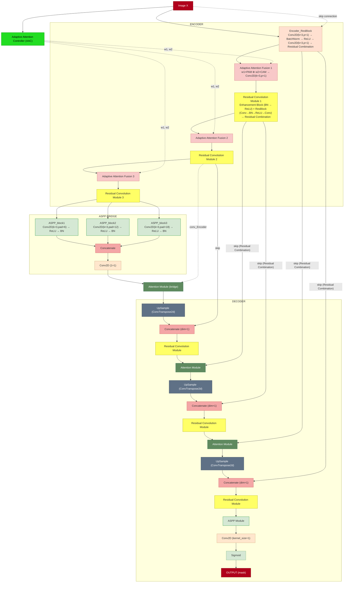
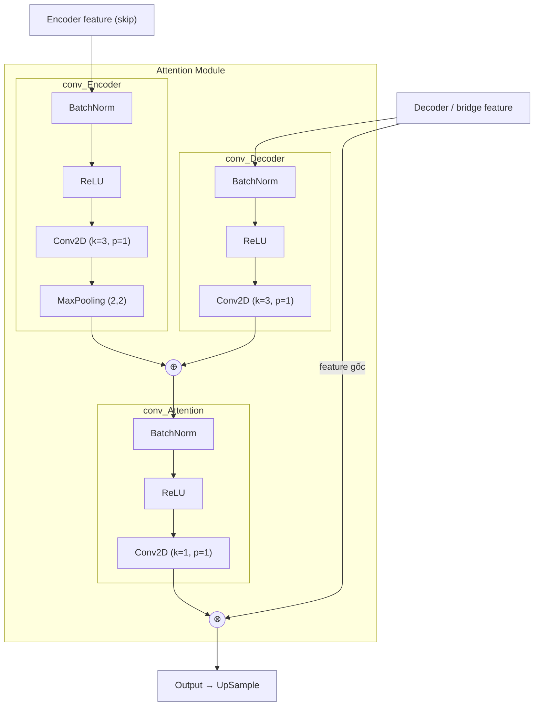

# CAAF-UNet Architecture (Figure 1) — dạng Markdown

Sơ đồ vẽ lại bằng Mermaid (GitHub, VS Code, Obsidian, Typora đều render được).
Chú thích: ⊕ = cộng từng phần tử, ⊗ = nhân từng phần tử, PAM = Position Attention Module, CAM = Channel Attention Module.

## 1. Sơ đồ tổng thể



> Lưu ý: trong hình gốc, các mũi tên skip từ encoder sang decoder chạy nhiều đường dài; sơ đồ trên nối đúng từng điểm nguồn (Residual Combination của từng tầng encoder) tới điểm đích (Attention Module hoặc Concatenate) của decoder.

## 2. Chi tiết Attention Module



## 3. Dạng văn bản (cây khối)

```text
Image X ──┬─► Adaptive Attention Controller (AAC) ──► (w1, w2) cấp cho 3 khối AAF
          │
          ▼
ENCODER
 ├─ Encoder_ResBlock : Conv2D(k3,p1) → BN → ReLU → Conv2D(k3,p1) → Residual Combination (+ skip từ X)
 ├─ AAF 1            : (w1 × PAM) ⊕ (w2 × CAM) → Conv2D(k3,p1)
 ├─ Residual Conv Module 1 : Enhancement Block (BN→ReLU) ∥ ResBlock (Conv→BN→ReLU→Conv) → Residual Combination
 ├─ AAF 2 → Residual Conv Module 2
 └─ AAF 3 → Residual Conv Module 3

BRIDGE (ASPP)
 ├─ ASPP_block1 : Conv2D(k3, pad 6)  → ReLU → BN
 ├─ ASPP_block2 : Conv2D(k3, pad 12) → ReLU → BN
 ├─ ASPP_block3 : Conv2D(k3, pad 18) → ReLU → BN
 └─ Concatenate → Conv2D(1×1)
      └─► Attention Module (kết hợp feature encoder + bridge) ──► UpSample

DECODER (lặp 3 tầng)
 UpSample(ConvTranspose2d) → Concatenate(dim=1, skip từ encoder) → Residual Conv Module → Attention Module → ...
 Tầng cuối: ... → Residual Conv Module → ASPP Module → Conv2D(k=1) → Sigmoid → OUTPUT
```

## 4. Bảng tóm tắt các khối

| Khối | Cấu tạo | Vai trò |
|---|---|---|
| AAC | Self-attention trên feature thu nhỏ 8×8 → FC → Softmax | Sinh trọng số thích nghi (w1, w2) |
| AAF | w1×PAM ⊕ w2×CAM → Conv2D(k3,p1) | Trộn position và channel attention |
| Residual Conv Module | Enhancement Block + ResBlock + Residual Combination | Trích xuất đặc trưng ổn định nhờ residual |
| ASPP | 3 nhánh dilation 6/12/18 → Concatenate → Conv 1×1 | Đặc trưng đa tỉ lệ |
| Attention Module | conv_Encoder, conv_Decoder → ⊕ → conv_Attention → ⊗ | Lọc skip connection |
| UpSample | ConvTranspose2d | Tăng độ phân giải |
| Đầu ra | Conv2D(k=1) → Sigmoid | Mask xác suất [0, 1] |
