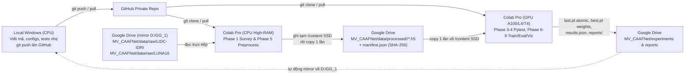

# SPECS — Đặc tả kỹ thuật phục dựng CAAF-ResUNet (theo từng Phase)

| Mục | Giá trị |
|---|---|
| Bài báo | *CAAF-ResUNet: Adaptive Attention Fusion with Boundary-Aware Loss for Lung Nodule Segmentation*, Medicina 2025, 61, 1126 |
| Nguồn | `docs/MARKDOWN/caaf_resunet_markdown/paper.md`, `caaf_unet_architecture.md` |
| Lý do của từng quyết định | `docs/SPEC_REVIEW.md` |
| Kế hoạch thực hiện | `docs/PLANNING/PLAN.md` (cấu trúc Phase 0 → Phase 9 khớp 1-1 với tài liệu này) |
| Sổ điểm mơ hồ | `docs/PLANNING/OPEN_ISSUES.md` (mã A*/B*/C*/… dùng trong tài liệu này) |
| Phiên bản | **v2.1 — 2026-11-21** (tổ chức theo **Phase 0 → Phase 9**, thuật toán chi tiết từng bước, luồng Colab Pro CPU High-RAM trực tiếp trên Google Drive; v2.1: cập nhật đường dẫn dữ liệu thô chuẩn đã đưa vào `MV_CAAFNet/data/raw/{LIDC-IDRI,LUNA16}` — bỏ hoàn toàn `pylidc`) |

Ký hiệu nguồn gốc thông số:
- **[P]** lấy trực tiếp từ bài báo (kèm số Eq./Table/Figure)
- **[A]** giả định của nhóm phục dựng vì bài báo không nêu → phải liệt kê trong `README.md`
- **[F]** sửa lỗi hoặc mâu thuẫn trong bài báo

Quy ước chung:
- Tensor 2D: `(B, C, H, W)` với `H = W = 64`. Mọi mask và xác suất có shape `(B, 1, H, W)`.
- Volume CT & mask 3D: luôn chuẩn hóa về trục **`(Z, Y, X)`** (lát cắt, hàng, cột) với `spacing = (spacing_z, spacing_y, spacing_x)` tính bằng mm ngay sau bước đọc dữ liệu.

---

## Tổng quan luồng làm việc (Local ↔ GitHub ↔ Google Drive ↔ Colab Pro)

Vì máy local không có GPU (CPU i3, 20 GB RAM) và ổ `D:\GG_1` đang được **mirror trực tiếp với Google Drive** (nên cả hai bộ dữ liệu thô ~235 GB đã nằm sẵn trên Drive), luồng làm việc chuẩn được thiết kế **Colab-first** để **không bao giờ phải chờ máy local xử lý nhiều giờ hay upload hàng GB lên Drive**:



### Nguyên tắc vận hành nhanh & an toàn trên Google Drive FUSE (Colab)

1. **Tách runtime theo tải việc**:
   - **Phase 1 (Survey) & Phase 5 (Preprocess)**: chạy trên **Colab Pro CPU High-RAM** (8–12 vCPU, ~51 GB RAM, tốn rất ít compute unit — không đốt GPU cho tác vụ I/O DICOM/MHD).
   - **Phase 3–4 (`pytest` mô hình/loss), Phase 6–9 (Train/Eval/Stats/Grad-CAM)**: chạy trên **Colab Pro GPU**.
2. **Tránh nghẽn Drive FUSE khi đọc 244.000 file DICOM**:
   - Bước lập chỉ mục (`build_index.py` ở Phase 1) đọc **header** (`stop_before_pixels=True`) một lần duy nhất → lưu `scan_index.json` + `seg_index.csv` lên Drive.
   - Với **LUNA16**: chỉ đọc 888 file `.mhd/.raw` + ~3.000 file `SEG_*.dcm` (tuyệt đối **không mở** 244.000 file CT DICOM của LIDC!).
   - Với **LIDC-IDRI**: dùng số luồng vừa phải (`workers = 2..4` trên Drive FUSE để không bị Google Drive throttle) và lưu tiến độ từng scan (`by_scan/<series_uid>/_DONE` + `.npz` nhỏ) trên Drive để **resume tức thì** nếu Colab ngắt phiên.
3. **Không bao giờ ghi HDF5 trực tiếp qua Drive FUSE**:
   - `pack_h5.py` luôn ghi `train.h5`, `val.h5`, `test.h5` (nén `gzip opts=4`) ra **SSD nội bộ `/content/processed_tmp/<ds>/`** trước, tính SHA-256 ghi `manifest.json`, sau đó copy **1 lần duy nhất** sang `DRIVE_ROOT/data/processed/<ds>/` (~10–20 giây trong mạng nội bộ Google).
4. **Script độc lập môi trường**: mọi script Python đều nhận đường dẫn qua CLI, nên vẫn có thể chạy test nhanh trên máy local với cờ `--limit 3` (xử lý thử 3 ca) trước khi đẩy lên Colab chạy toàn bộ.

---

## Phase 0 — Môi trường, Cấu trúc Repo & Cấu hình

### 0.1 Môi trường & Thư viện

| Nơi | Python | Thư viện | Vai trò |
|---|---|---|---|
| **Local (Windows CPU)** | **3.12.10** (`.python-version`) | `requirements-local.txt` | Chỉnh sửa mã, chạy `pytest` cấu hình/tiện ích nhẹ, debug `--limit 3` nếu cần, `git push`. **Không** cần `torch`, **không** cần `pylidc`. |
| **Colab Pro (CPU High-RAM)** | Mặc định của Colab (3.11/3.12) | `requirements-colab.txt` | Phase 1 (khảo sát), Phase 5 (tiền xử lý LIDC & LUNA16, chia tập, đóng gói `.h5` lên Drive). |
| **Colab Pro (GPU)** | Mặc định của Colab | `requirements-colab.txt` + `torch` có sẵn | Phase 3–4 (`pytest` GPU/CPU), Phase 6–9 (train, evaluate, stats, Grad-CAM, báo cáo). |

Vì dữ liệu `data/raw/LIDC-IDRI` thực tế là bản **NCI IDC DICOM-SEG** (`CT_*/*.dcm` + `SEG_*/*.dcm`), toàn bộ pipeline đọc trực tiếp bằng `pydicom` và `SimpleITK`, **loại bỏ hoàn toàn phụ thuộc `pylidc`**, không cần `SQLAlchemy<2`, không cần `numpy<2`, không cần cấu hình `~/.pylidcrc`.

`requirements-local.txt` và `requirements-colab.txt` dùng chung lõi thư viện gọn nhẹ (không ghim `torch`/`torchvision` trên Colab):
```
numpy
scipy
pandas
h5py
pyyaml
pydicom
SimpleITK
scikit-image
matplotlib
tqdm
pytest
```

Quy định tương thích Python 3.12 & PyTorch ≥ 2.1 (kể cả PyTorch 2.6+ trên Colab):
- Dùng `torch.amp.autocast("cuda")` và `torch.amp.GradScaler("cuda")` thay API cũ `torch.cuda.amp.*`.
- Khi nạp checkpoint đầy đủ (`last.pt` chứa `rng`, `cfg`), luôn dùng `torch.load(path, map_location=..., weights_only=False)`.
- Không dùng thư viện ngoài cho Grad-CAM hay attention.

### 0.2 Cấu trúc repo đích & ánh xạ Drive

```
MV_CAAFNet/                                  # mirror trực tiếp giữa D:\GG_1\...\CT208E\MV_CAAFNet và Drive
├── .python-version                          # 3.12.10
├── .gitignore                               # .venv/, desktop.ini, data/, experiments/, *.pt, *.h5, *.npz, .ipynb_checkpoints/
├── README.md                                # cách chạy + bảng giả định [A]/[F] + kết quả
├── requirements-local.txt
├── requirements-colab.txt
├── configs/
│   ├── base.yaml                            # §0.3.2
│   ├── data.yaml                            # §0.3.4
│   └── <10 config thực nghiệm>.yaml         # §0.3.3
├── data/                                    # (gitignore; mirror trực tiếp với Drive)
│   ├── raw/
│   │   ├── LIDC-IDRI/                       # 1.010 bệnh nhân, 1.018 CT scan, NCI IDC DICOM-SEG
│   │   └── LUNA16/                          # subset0..9/*.mhd/.raw, 888 scan, annotations.csv
│   ├── index/                               # ct_scans.csv, seg_index.csv, luna16_scans.csv, index_summary.json (Phase 1)
│   ├── interim/{lidc,luna16}/               # by_scan/<series_uid>/ + patches_hu.npy, masks.npy, patches.csv, errors.csv
│   ├── splits/{lidc,luna16}.json            # kết quả chia tập (Phase 5)
│   └── processed/{lidc,luna16}/             # {train,val,test}.h5 + patches.csv + <ds>.json + manifest.json
├── src/
│   ├── __init__.py                          # tệp rỗng để chạy `python -m src.<module>`
│   ├── utils.py                             # Phase 2
│   ├── models/                              # Phase 3: blocks, aspp, attention, aac, aaf, caaf_resunet, resunetpp
│   ├── losses/                              # Phase 4: dice, sobel, laplacian, hausdorff_edt, bal
│   ├── metrics.py                           # Phase 4
│   ├── data/                                # Phase 1, 4, 5: build_index, ct_utils, compute_edt, preprocess_lidc, preprocess_luna16, make_splits, pack_h5, dataset
│   ├── train.py                             # Phase 6
│   ├── evaluate.py                          # Phase 6
│   ├── stats_test.py                        # Phase 9
│   ├── report.py                            # Phase 9
│   └── visualize.py                         # Phase 9
├── notebooks/                               # Phụ lục B (đủ 100% tham số CLI ở cell đầu)
│   ├── 00_colab_data_survey.ipynb           # Colab CPU High-RAM (Phase 1)
│   ├── 01_colab_preprocess.ipynb            # Colab CPU High-RAM (Phase 5)
│   ├── 10_colab_train.ipynb                 # Colab GPU (Phase 3-4 pytest, Phase 6-8)
│   ├── 11_colab_evaluate.ipynb              # Colab GPU (Phase 6-8b)
│   └── 12_colab_stats_figures.ipynb         # Colab GPU (Phase 9)
├── tests/                                   # Phụ lục C
├── experiments/                             # (gitignore; lưu trên Drive)
└── reports/                                 # bảng .md + figures/ (mirror về local tự động)
```

Lưu ý `.venv`: nếu đặt `.venv` trong `D:\GG_1` làm Google Drive Desktop đồng bộ hàng nghìn tệp nhỏ chậm, đặt `.venv` ở ổ cục bộ ngoài `D:\GG_1` (ví dụ `C:\venvs\mv_caafnet`) và dùng Python đó khi chạy lệnh local.

### 0.3 Cấu hình YAML (`configs/`)

#### 0.3.1 Cơ chế kế thừa & ghi đè
- Mỗi config con có khóa `base: base.yaml` (đường dẫn tương đối so với tệp config). `load_config(path)` đọc đệ quy `base` trước rồi **deep-merge** config con đè lên.
- `--set a.b.c=value` (lặp nhiều lần) ghi đè sau khi merge và sau các cờ tắt CLI; `value` parse bằng `yaml.safe_load` (`8` → int, `1e-4` → float, `[1,2]` → list, `true` → bool). Khóa không tồn tại trong cây config → **báo lỗi `KeyError`** (chống gõ sai tên khóa).
- Config cuối cùng được lưu ra `<run_dir>/config_resolved.yaml` (có sẵn trường `dataset`). `evaluate.py`, `visualize.py` và `report.py` đọc trực tiếp tệp này.

#### 0.3.2 `configs/base.yaml`
```yaml
seed: 42                                   # [A]
dataset: null                              # gán từ CLI --dataset khi train và lưu vào config_resolved.yaml
model:
  name: caaf_resunet                       # caaf_resunet | resunetpp
  in_channels: 1                           # [P] CT 1 kênh
  channels: [32, 64, 128, 256]             # [P] §2.1: 64×64×32 … 8×8×256
  upsample: convtranspose                  # [P] Figure 1: ConvTranspose2d(ch→ch, k=2, s=2 [A])
  aac:
    pool_size: 8                           # [P] Alg. 1, H'=W'=8
    qkv_bias: false                        # [A] Eq. 3 không có bias
  attention:
    pam_reduction: 8                       # [A] DANet: Q, K có C/8 kênh
    att_sigmoid: false                     # [A] AttentionModule decoder không dùng sigmoid mặc định
  aspp:
    rates: [6, 12, 18]                     # [P]
    gap: false                             # [A] Figure 1 không vẽ GAP; để tùy chọn
  se_reduction: 8                          # [A] chỉ dùng cho resunetpp
aaf:
  mode: adaptive                           # pa | ca | static | adaptive (bỏ qua khi model.name=resunetpp)
  static_weights: [0.5, 0.5]               # [P] Exp. 2
loss:
  name: dice                               # dice | dice+sobel | dice+laplacian | dice+hausdorff
  lambda: 1.0                              # [P] Eq. 14 không có hệ số
  dice_eps: 1.0e-6                         # [A]
  sobel_eps: 1.0e-8                        # [A] ε trong căn bậc hai
  hausdorff_mode: soft_pg_detach_gp        # [A] soft_pg_detach_gp | bidir_soft | karimi_sq (S3)
  hausdorff_empty_value: 90.51             # [A] 64·√2, dùng khi P nhị phân rỗng
data:
  patch_size: 64                           # [P]
  augment: false                           # [A] bài báo không nhắc augmentation
  num_workers: 2
train:
  epochs: 100                              # [P] Figure 2
  batch_size: 16                           # [A]
  optimizer:
    name: adamw                            # [P]
    lr: 1.0e-4                             # [P]
    weight_decay: 0.01                     # [A] mặc định PyTorch
    betas: [0.9, 0.999]                    # [A]
  scheduler:
    name: steplr                           # [P]
    step_size: 30                          # [P]
    gamma: 0.1                             # [P]
  amp: false                               # [A] bật nếu GPU thiếu bộ nhớ
  grad_clip: null                          # [A]
  deterministic: false
eval:
  threshold: 0.5                           # [A]
  ckpt: last                               # [A] bài báo không có tập val → báo cáo chính dùng last
```

#### 0.3.3 Mười config thực nghiệm (`configs/<name>.yaml`, chỉ ghi phần khác `base.yaml`)

| Tệp | `model.name` | `aaf.mode` | `loss.name` | Dùng cho |
|---|---|---|---|---|
| `baseline_resunetpp.yaml` | `resunetpp` | — | `dice` | Table 7 |
| `pa_resunet.yaml` | `caaf_resunet` | `pa` | `dice` | Table 7 |
| `ca_resunet.yaml` | `caaf_resunet` | `ca` | `dice` | Table 7 |
| `pcam_dice.yaml` | `caaf_resunet` | `static` | `dice` | Table 7 |
| `pcam_sobel.yaml` | `caaf_resunet` | `static` | `dice+sobel` | Table 6 |
| `pcam_laplacian.yaml` | `caaf_resunet` | `static` | `dice+laplacian` | Table 6 |
| `pcam_hausdorff.yaml` | `caaf_resunet` | `static` | `dice+hausdorff` | Table 6 |
| `caaf_sobel.yaml` | `caaf_resunet` | `adaptive` | `dice+sobel` | Table 5, 6 |
| `caaf_laplacian.yaml` | `caaf_resunet` | `adaptive` | `dice+laplacian` | Table 5, 6 |
| `caaf_hausdorff.yaml` | `caaf_resunet` | `adaptive` | `dice+hausdorff` | Table 5, 6, 7 |

#### 0.3.4 `configs/data.yaml`
```yaml
paths:
  # Đường dẫn mặc định trên Colab (nằm trong DRIVE_ROOT/data/raw/Extracted; ghi đè qua CLI khi chạy local)
  lidc_raw: "/content/drive/MyDrive/COMPUTER SCIENCE/NAM4_HK1_(2026-2027)/CT208E/MV_CAAFNet/data/raw/Extracted/LIDC-IDRI"
  luna16_raw: "/content/drive/MyDrive/COMPUTER SCIENCE/NAM4_HK1_(2026-2027)/CT208E/MV_CAAFNet/data/raw/Extracted/LUNA16"
  index_dir: "/content/drive/MyDrive/COMPUTER SCIENCE/NAM4_HK1_(2026-2027)/CT208E/MV_CAAFNet/data/index"
common:
  patch_size: 64
  hu_floor: -1000                # [A] cắt đáy HU (vùng ngoài khung quét của .mhd là -3024/-2048)
  hu_window: [-1000, 400]        # [A] cửa sổ phổi; ứng viên khác [-1000, 150] — chốt ở Phase 1 (B9)
  pad_value_hu: -1000            # [A] pad bằng giá trị không khí khi patch chạm biên ảnh
  resample_mm: null              # [A] null = giữ spacing gốc; 1.0 = đưa mặt phẳng trục về 1 mm/pixel (B10)
  resample_order: 1              # nội suy ảnh (1 = tuyến tính); mask luôn order 0
  min_mask_area_px: 1            # [A] bỏ lát có diện tích mask < ngưỡng — chốt ở Phase 1 (B6)
  include_other_nodules: true    # [A] nốt khác (đã qua lọc) lọt vào patch cũng gán nhãn 1 (B8)
  center_jitter_px: 0            # [A] 0 = tâm cố định; 8 = jitter ±8 px cho S5 (Phase 8b)
  workers: 4                     # 2–4 trên Colab Drive FUSE để không bị throttle
lidc:
  clevel: 0.5                    # [A] đồng thuận >= ceil(clevel * n_readers) (khớp chuẩn pylidc >= clevel)
  min_readers: 1                 # [A] chốt ở Phase 1 để tổng patch gần 15.128 (13.928 + 1.200)
  min_diameter_mm: 3.0           # [A] đường kính tương đương 3D (hoặc max-2D, chốt ở Phase 1) >= 3 mm
luna16:
  annotations_csv: annotations.csv
  match_tolerance: radius        # khớp cụm DICOM-SEG ↔ annotations.csv khi khoảng cách tâm <= diameter_mm / 2
  clevel: 0.5
split:
  mode: patient                  # [A] patient (chuẩn) | slice (chỉ dùng cho S1 ở Phase 8b)
  seed: 2024                     # [A]
  test_patches: 1200             # [P] Table 4
  val_ratio: 0.1                 # [A] theo bệnh nhân (max(1, round(0.1 * n_remaining))), trên phần còn lại sau khi tách test
```

---

## Phase 1 — Khảo sát dữ liệu & Lập chỉ mục (`src/data/build_index.py`, `notebooks/00_colab_data_survey.ipynb`)

### 1.1 Bố cục dữ liệu thô thực tế (đã kiểm chứng trên đĩa)

1. **`data/raw/LIDC-IDRI`** (chuẩn **NCI IDC DICOM-SEG**):
   - Gồm **1.010** thư mục bệnh nhân `LIDC-IDRI-0001` … `LIDC-IDRI-1012` (1.002 bệnh nhân có 1 thư mục `CT_*`, **8 bệnh nhân có 2 thư mục `CT_*`** → tổng **1.018 CT scan**; 135 bệnh nhân có 0 thư mục `SEG_*`).
   - Bên trong mỗi `LIDC-IDRI-XXXX/`:
     - `CT_<id>/00000001.dcm …`: các lát CT DICOM 2D (`512×512`, có `SeriesInstanceUID`, `SOPInstanceUID`, `ImagePositionPatient`, `ImageOrientationPatient`, `PixelSpacing`, `RescaleSlope`, `RescaleIntercept`).
     - `SEG_<id>/00000001.dcm`: **mỗi tệp SEG tương ứng 1 bác sĩ vẽ 1 nốt**, chứa:
       - `ReferencedSeriesSequence[0].SeriesInstanceUID`: liên kết chính xác 1-1 tới `CT_*` scan (giải quyết hoàn toàn 8 bệnh nhân có 2 scan) **và** trùng khớp trực tiếp với `seriesuid` của LUNA16.
       - `SeriesDescription` / `SegmentSequence[0].SegmentLabel`: dạng `"Segmentation of Nodule <K> - Annotation <ID>"` (IDC đã gom cụm sẵn theo mã nốt `Nodule <K>`).
       - `SharedFunctionalGroupsSequence[0]`: `PixelMeasuresSequence` (`PixelSpacing`, `SliceThickness`) và `PlaneOrientationSequence` (`ImageOrientationPatient`).
       - `PerFrameFunctionalGroupsSequence[i]`: mỗi frame `i` có `DerivationImageSequence[0].SourceImageSequence[0].ReferencedSOPInstanceUID` (trỏ thẳng vào lát CT) **và** `PlanePositionSequence[0].ImagePositionPatient` `(x_mm, y_mm, z_mm)`.
2. **`data/raw/LUNA16`**:
   - `subset0` … `subset9`: tổng **888** cặp `<seriesuid>.mhd` + `<seriesuid>.raw` (`ElementType = MET_SHORT`, HU trực tiếp).
   - `annotations.csv`: **1.186** dòng nốt thuộc **601** `seriesuid` duy nhất (`287` scan còn lại không có nốt công nhận), gồm các cột `seriesuid, coordX, coordY, coordZ, diameter_mm`.

### 1.2 Thuật toán lập chỉ mục nhanh (`src/data/build_index.py`)

CLI: `--lidc-dir`, `--luna16-dir`, `--out-dir` (mặc định `data/index`), `--workers` (mặc định `4`).

Mục đích: quét **một lần duy nhất** trên Colab CPU High-RAM để xây dựng bản đồ ánh xạ toàn cục (không phải quét lại 244.000 file DICOM ở các bước sau):

```text
Thuật toán build_index(lidc_dir, luna16_dir, out_dir):
1. Duyệt mọi thư mục bệnh nhân p_dir = LIDC-IDRI-* trong lidc_dir (đã sorted):
   a. Với mỗi thư mục con CT_* trong p_dir:
      - Đọc DUY NHẤT 1 file .dcm đầu tiên bằng pydicom.dcmread(..., stop_before_pixels=True).
      - Trích: patient_id, series_uid, ct_rel_dir, n_dcm_files, rows, cols,
               pixel_spacing (sy, sx), slice_thickness, iop (6 số).
      - Gán scan_idx = 0, 1, ... theo thứ tự series_uid tăng dần trong từng patient_id.
   b. Với mỗi file SEG_*/*.dcm trong p_dir:
      - Đọc header bằng pydicom.dcmread(..., stop_before_pixels=True).
      - Trích: ref_series_uid = ReferencedSeriesSequence[0].SeriesInstanceUID,
               seg_rel_path, series_desc, segment_label, n_frames,
               pixel_spacing, iop, z_min, z_max (từ PerFrameFunctionalGroupsSequence).
      - Parse nodule_key bằng regex `Nodule\s+(\d+)` trên segment_label (hoặc series_desc).
        Nếu không khớp regex → gắn cờ `label_anomaly=True` để báo cáo ở Phase 1.1.
2. Quét data/raw/LUNA16/subset0..9/*.mhd (chỉ đọc tệp text .mhd vài trăm byte, KHÔNG đọc .raw):
   - Trích: series_uid, subset, mhd_rel_path, dim_size (X,Y,Z), spacing (sx,sy,sz),
            offset (ox,oy,oz), transform_matrix (9 số).
   - Gắn thêm số dòng trong annotations.csv và số tệp SEG tìm thấy theo ref_series_uid.
3. Ghi kết quả ra out_dir:
   - ct_scans.csv     (1.018 dòng: mỗi CT scan LIDC)
   - seg_index.csv    (~6.000+ dòng: mỗi tệp DICOM-SEG → ref_series_uid, nodule_key)
   - luna16_scans.csv (888 dòng: mỗi .mhd + trạng thái có mặt trong LIDC & annotations.csv)
   - index_summary.json (tổng quan lỗi/dị biệt, số scan có Direction != I, số label_anomaly)
```

### 1.3 Nội dung khảo sát & Cổng quyết định (`notebooks/00_colab_data_survey.ipynb`)

Chạy trên Colab CPU High-RAM dựa trên `data/index/` + đọc pixel `SEG` (nhẹ) và một phần mẫu CT:
1. **Xác nhận cấu trúc & tính toàn vẹn (P1.1–1.2)**:
   - Assert toàn bộ `SEG` parse được `nodule_key` (hoặc liệt kê các ca dị biệt để xử lý fallback).
   - Xác nhận 601/601 `series_uid` dương tính trong `data/raw/LUNA16/annotations.csv` đều có `SEG` tương ứng trong `seg_index.csv`.
2. **Thống kê phân bố LIDC-IDRI (P1.3–1.4)**:
   - Đếm số bệnh nhân, số scan, số cụm nốt theo `n_readers ∈ {1, 2, 3, 4}`, tổng số lát cắt có mask theo `min_readers ∈ {1, 2, 3, 4}` và `min_mask_area_px ∈ {1, 5, 10}` → chọn bộ tham số cho tổng gần **15.128** patch (13.928 + 1.200) nhất.
3. **Kiểm tra khớp toàn bộ 888 scan / 1.186 nốt LUNA16 ↔ DICOM-SEG (P1.5 — B15)**:
   - Chạy bước ánh xạ tọa độ + khớp `annotations.csv` (xem §5.3) trên toàn bộ 601 scan dương tính; báo cáo tỉ lệ khớp 1-1, số ca 0-khớp/đa-khớp, số scan có `Direction` hoặc `IOP` khác ma trận đơn vị.
   - Vẽ chồng mask consensus lên lát `.mhd` ở **5 scan** (ưu tiên gồm cả ca có `Direction != I` nếu tồn tại) để xác minh bằng mắt không bị lệch/lật trục.
4. **Chốt các giả định B6, B8, B9, B10, B17 (P1.6–1.9)**:
   - Phân bố `area_nodule_px` (B6), tỉ lệ `n_other_nodules > 0` (B8), percentile 5–95 của HU trong mask trên mẫu ngẫu nhiên 50 scan (B9: `[-1000, 400]` vs `[-1000, 150]`), phân bố `spacing_x/y` (B10: giữ `resample_mm: null` nếu đa số < 1 mm), tỉ lệ `touches_border` (B17).
5. **Cổng quyết định**: chốt toàn bộ tham số vào `configs/data.yaml`; nếu số patch ước lượng lệch > 20% so với Table 4 thì ghi nguyên nhân vào `README.md` (không ép số).

---

## Phase 2 — Hạ tầng dùng chung (`src/utils.py`, `tests/test_config.py`)

### 2.1 Thuật toán các hàm trong `src/utils.py`

| Hàm | Chữ ký & Thuật toán chi tiết |
|---|---|
| `load_config` | `(path: str \| Path, overrides: list[str] \| None = None) -> dict`. Đọc YAML `path`; nếu có khóa `base`, giải quyết đường dẫn tương đối theo `Path(path).parent`, đệ quy nạp cha rồi `deep_merge(parent, child)` (dict merge đệ quy, list/scalar thay thế), xóa khóa `base`. Sau đó duyệt `overrides` dạng `a.b.c=val`: tách theo `.`, duyệt từng khóa trung gian — nếu bất kỳ khóa nào không tồn tại → raise `KeyError`; parse `val` bằng `yaml.safe_load(val)` và gán. |
| `add_common_args` | `(parser)` thêm 5 cờ: `--config` (required), `--dataset` (`choices=["luna16", "lidc"]`, required), `--data-dir` (default `"data/processed"`), `--out-dir` (default `"experiments"`), `--set` (`action="append"`, default `[]`). |
| `add_train_shortcuts` | `(parser)` thêm 11 cờ tắt (§6.1.1), mọi cờ mặc định `None` (`--amp/--no-amp` và `--augment/--no-augment` dùng `argparse.BooleanOptionalAction`, default `None`). |
| `apply_overrides` | `(base_cfg: dict, args) -> dict`. Sao chép sâu `base_cfg`. Bước 1: áp các cờ tắt khác `None` theo bảng ánh xạ §6.1.1. Bước 2: áp danh sách `args.set` (nên `--set` thắng cờ tắt, cờ tắt thắng `--config`, `--config` thắng `base.yaml`). Bước 3: gán `resolved["dataset"] = args.dataset`. |
| `make_run_name` | `(cfg_path, config_only_cfg, resolved_cfg, args) -> (run_name: str, overrides_dict: dict)`. Nếu `args.run_name` khác `None` → trả thẳng `args.run_name`. Ngược lại: `stem = Path(cfg_path).stem`, `seed = resolved_cfg["seed"]`, `base_name = f"{stem}_s{seed}"`. So sánh từng khóa của 10 cờ tắt (trừ `seed`) giữa `resolved_cfg` và `config_only_cfg`: nếu khác thì thêm token đúng thứ tự cố định (§6.1.2). Với `--set`: lọc bỏ khóa `"seed"` và các khóa trùng giá trị `config_only_cfg`; nếu còn phần tử thì sort theo `(key, repr(val))`, tính `sha1` lấy 6 ký tự đầu → thêm `set-<hash6>`. Nếu có ít nhất 1 token → `f"{base_name}__{'_'.join(tokens)}"`. |
| `seed_everything` | `(seed: int, deterministic: bool = False)` — đặt seed cho `random`, `numpy`, và (lazy import `torch`) `torch.manual_seed`, `torch.cuda.manual_seed_all`; thiết lập `cudnn.deterministic` / `cudnn.benchmark`. |
| `get_logger` | `(name: str, log_file: Path \| None = None)` — console + tùy chọn ghi file UTF-8, tránh gắn trùng handler. |
| `save_checkpoint` | `(path: Path, state: dict)` — import `torch` lười (lazy); ghi ra `<path>.tmp` (hoặc `/tmp` nếu truyền `tmp_dir` trên Colab Drive FUSE) rồi `os.replace(tmp, path)` để atomic. |
| `load_checkpoint` | `(path: Path, map_location="cpu") -> dict` — import `torch` lười, gọi `torch.load(path, map_location=map_location, weights_only=False)`. |
| `git_commit` | `() -> str` — chạy `git rev-parse HEAD` (fallback `"unknown"` nếu ngoài git repo). |

### 2.2 Kiểm thử Phase 2 (`tests/test_config.py`, chạy ngay ở local không cần torch)
- Merge `base.yaml` + config con nhiều tầng; `--set train.batch_size=8` ra `int`; khóa sai → `KeyError`.
- Thứ tự ưu tiên: `base.yaml` < `--config` < cờ tắt < `--set`.
- `make_run_name` tất định; cờ tắt trùng giá trị gốc không sinh token; `--seed 7` và `--set seed=7` sinh **cùng một tên run**; `dataset` có mặt trong `resolved_cfg`.

---

## Phase 3 — Kiến trúc mô hình (`src/models/`)

Quy ước chung:
- Mọi `Conv2d` có `bias=True`, trừ `Conv2d` đứng ngay trước `BatchNorm2d` có `bias=False` [A].
- Khởi tạo trọng số & BN: mặc định của PyTorch (`Kaiming-uniform`; BN `momentum=0.1`, `eps=1e-5`) [A] (C10). **Không dùng Dropout** [A] (C11).

### 3.1 Khối cơ bản — `src/models/blocks.py`

| Lớp | Chữ ký | Thuật toán `forward(x)` | Nguồn |
|---|---|---|---|
| `StemBlock` | `(in_ch, out_ch)` | `main = Conv3×3(in→out, p=1, bias=False) → BN → ReLU → Conv3×3(out→out, p=1)`; `skip = Conv3×3(in→out, p=1, bias=False) → BN`; `return main + skip` | [P] Fig. 1; skip [A] theo ResUNet++ |
| `ResidualConvModule` | `(in_ch, out_ch, stride=1)` | `main = BN(in) → ReLU → Conv3×3(in→out, s=stride, p=1, bias=False) → BN(out) → ReLU → Conv3×3(out→out, p=1)`; `skip = Conv3×3(in→out, s=stride, p=1, bias=False) → BN(out)`; `return main + skip` | [P] Fig. 1; stride [A] |
| `AttentionModule` | `(enc_ch, dec_ch, att_sigmoid=False)` | `e = MaxPool2d(2)(Conv3×3(enc→dec, p=1)(ReLU(BN(enc)(x_enc))))`; `d = Conv3×3(dec→dec, p=1)(ReLU(BN(dec)(x_dec)))`; `a = Conv1×1(dec→1, p=0)(ReLU(BN(dec)(e + d)))`; nếu `att_sigmoid`: `a = sigmoid(a)`; `return a * x_dec` | [P] Fig. 1 §2; `p=0` [F] A4; 1 kênh, không sigmoid mặc định [A] C6/C13 |
| `SEBlock` | `(ch, reduction=8)` | `s = AdaptiveAvgPool2d(1)(x).flatten(1)`; `s = Sigmoid(Linear(ch//r → ch)(ReLU(Linear(ch → ch//r)(s))))`; `return x * s.view(B, ch, 1, 1)` | [A] ResUNet++ (C8, G8) |
| `UpSample` | `(ch)` | `ConvTranspose2d(ch, ch, kernel_size=2, stride=2)` (giữ nguyên số kênh `ch` [A] C12) | [P] Fig. 1; `ch→ch, k=2, s=2` [A] |

### 3.2 ASPP — `src/models/aspp.py`
`ASPP(in_ch, out_ch, rates=(6, 12, 18), gap=False)`:
```text
branches = []
for r in rates:
    # Thứ tự đúng Figure 1: Conv → ReLU → BN [P]
    b_r = BN(out_ch)(ReLU(Conv2d(in_ch, out_ch, k=3, padding=r, dilation=r, bias=True)(x)))
    branches.append(b_r)
if gap:
    g = AdaptiveAvgPool2d(1)(x)
    g = BN(out_ch)(ReLU(Conv2d(in_ch, out_ch, k=1)(g)))
    g = F.interpolate(g, size=x.shape[-2:], mode="nearest")
    branches.append(g)
return Conv2d(len(branches) * out_ch, out_ch, k=1)(torch.cat(branches, dim=1))
```
*(Ghi chú: ở 8×8, nhánh dilation 12 và 18 chỉ chạm điểm tâm; vẫn giữ nguyên theo bài báo.)*

### 3.3 PAM & CAM — `src/models/attention.py` (theo DANet [A] C1)
Softmax luôn tính ở **`fp32`** (`x.float()`) kể cả khi bật AMP, rồi ép lại kiểu gốc.

`PAM(ch, reduction=8)`:
```text
B, C, H, W = x.shape; N = H * W; C' = max(1, ch // reduction)
q = Conv1×1(C→C')(x).view(B, C', N).transpose(1, 2)    # (B, N, C')
k = Conv1×1(C→C')(x).view(B, C', N)                     # (B, C', N)
v = Conv1×1(C→C)(x).view(B, C, N)                       # (B, C, N)
A = softmax((q.float() @ k.float()), dim=-1).to(x.dtype)# (B, N, N)
out = (v @ A.transpose(1, 2)).view(B, C, H, W)
return gamma * out + x                                  # gamma: nn.Parameter(torch.zeros(1))
```

`CAM(ch)`:
```text
B, C, H, W = x.shape; N = H * W
X = x.view(B, C, N)
E = X.float() @ X.float().transpose(1, 2)               # (B, C, C)
E_shift = E.max(dim=-1, keepdim=True).values - E        # công thức DANet chống tràn số
A = softmax(E_shift, dim=-1).to(x.dtype)                # (B, C, C)
out = (A @ X).view(B, C, H, W)
return gamma * out + x                                  # gamma: nn.Parameter(torch.zeros(1))
```
*(C14: Ở 64×64, `N = 4096` khiến giá trị `E = X @ X^T` có thể lớn → bắt buộc kiểm tra độ lớn gradient của `CAM` trong `test_grad_flow.py` để bảo đảm `softmax(E_shift)` không bão hòa thành one-hot.)*

### 3.4 AAC — `src/models/aac.py` [P] Algorithm 1, Eq. 1–9
`AAC(in_ch=32, pool_size=8, qkv_bias=False)`:
```text
F_ds  = F.adaptive_avg_pool2d(F_in, (pool_size, pool_size))     # (B, C, 8, 8)   Eq. 1
F_seq = F_ds.flatten(2).transpose(1, 2)                         # (B, 64, C)     Eq. 2
Q, K, V = W_q(F_seq), W_k(F_seq), W_v(F_seq)                    # Linear(C, C, bias=qkv_bias) Eq. 3
A     = softmax((Q.float() @ K.float().transpose(-2, -1)) / sqrt(C), dim=-1).to(F_seq.dtype) # Eq. 4
F_sa  = A @ V                                                   # (B, 64, C)     Eq. 5
F_g   = F_sa.mean(dim=1)                                        # (B, C)         Eq. 6
h     = ReLU(Linear(C, C // 2)(F_g))                            # (B, 16)        Eq. 7
z     = Linear(C // 2, 2)(h)                                    # (B, 2)         Eq. 8
w     = softmax(z.float(), dim=-1).to(F_in.dtype)               # (B, 2)         Eq. 9
return w
```
- Đầu vào là `F0 = stem(x)` (`C = 32`), chạy **1 lần duy nhất** mỗi forward, dùng chung `w` cho cả 3 tầng AAF [P] Figure 1.

### 3.5 AAF — `src/models/aaf.py` [P] Eq. 11–12
`AAF(ch, mode, pam_reduction=8, static_weights=(0.5, 0.5))`:
- `mode == "pa"`: chỉ khởi tạo `PAM(ch)` → `fused = PAM(x)`.
- `mode == "ca"`: chỉ khởi tạo `CAM(ch)` → `fused = CAM(x)`.
- `mode == "static"`: khởi tạo `PAM + CAM`, lưu `static_weights` trong `register_buffer` (không học) → `fused = w1_s * PAM(x) + w2_s * CAM(x)`.
- `mode == "adaptive"`: khởi tạo `PAM + CAM` → `w1 = w[:, 0].view(B, 1, 1, 1)`, `w2 = w[:, 1].view(B, 1, 1, 1)` → `fused = w1 * PAM(x) + w2 * CAM(x)`.
- Đầu ra: `Conv2d(ch, ch, kernel_size=3, padding=1)(fused)` [P] Figure 1 (không BN/ReLU sau trộn — C2). **Quy ước cố định: `w1` nhân PA, `w2` nhân CA** [P] Eq. 12, Table 5.

### 3.6 Mạng tổng thể — `src/models/caaf_resunet.py` & `src/models/resunetpp.py`
`ResUNetFamily(in_ch=1, channels=(32,64,128,256), enc_attn: Literal["se","pa","ca","static","adaptive"], ...)`:
```text
# Encoder
x1 = stem(x)                         # (B,  32, 64, 64)
w  = aac(x1) if adaptive else (      # (B, 2) hoặc hằng / None
       const([0.5,0.5]) if static else const([1,0]) if pa else const([0,1]) if ca else None)
a1 = enc_attn1(x1, w)                # (B,  32, 64, 64) — AAF hoặc SE
x2 = rcm1(a1, stride=2)              # (B,  64, 32, 32)
a2 = enc_attn2(x2, w)                # (B,  64, 32, 32)
x3 = rcm2(a2, stride=2)              # (B, 128, 16, 16)
a3 = enc_attn3(x3, w)                # (B, 128, 16, 16)
x4 = rcm3(a3, stride=2)              # (B, 256,  8,  8)
# Bridge
b  = aspp_bridge(x4)                 # (B, 256,  8,  8)  ASPP(256→256)
# Decoder (AttentionModule kiểu ResUNet++ [F] A3; skip lấy từ x1,x2,x3 trước AAF [P] Fig. 1)
d  = att1(enc=x3, dec=b)             # x3: 16×16 → MaxPool → 8×8, khớp b: 8×8 [P] Fig. 1 gốc
d  = torch.cat([up1(d), x3], dim=1)  # (B, 256+128=384, 16, 16)
d  = rcm_d1(d, stride=1)             # (B, 128, 16, 16)
d  = att2(enc=x2, dec=d)             # x2: 32×32 → MaxPool → 16×16
d  = torch.cat([up2(d), x2], dim=1)  # (B, 128+64=192, 32, 32)
d  = rcm_d2(d, stride=1)             # (B,  64, 32, 32)
d  = att3(enc=x1, dec=d)             # x1: 64×64 → MaxPool → 32×32
d  = torch.cat([up3(d), x1], dim=1)  # (B,  64+32=96,  64, 64)
d  = rcm_d3(d, stride=1)             # (B,  32, 64, 64)
# Head
d  = aspp_out(d)                     # (B,  32, 64, 64)  ASPP(32→32)
logits = Conv1×1(32→1)(d)            # (B,   1, 64, 64)
return {"prob": torch.sigmoid(logits), "logits": logits, "w": w, "feats": {"aaf1": a1, "aaf2": a2, "aaf3": a3}}
```
- `build_model(cfg)`: `model.name == "resunetpp"` → `ResUNetFamily(enc_attn="se")` (wrapper trong `resunetpp.py`); `model.name == "caaf_resunet"` → `ResUNetFamily(enc_attn=cfg["aaf"]["mode"])`.

### 3.7 Kiểm thử Phase 3 (chạy trên Colab Pro qua `10_colab_train.ipynb` `RUN_PYTEST=True`)
- `test_shapes.py`, `test_aac.py`, `test_aaf_modes.py`, `test_grad_flow.py` (phần model + kiểm tra CAM 64×64 không bão hòa) → xem Phụ lục C.
- Sinh bảng số tham số 5 biến thể ghi vào `reports/model_params.md` và đo VRAM đỉnh batch 16.

---

## Phase 4 — Hàm mất mát, EDT & Độ đo (`src/losses/`, `src/data/compute_edt.py`, `src/metrics.py`)

Mọi loss nhận `prob` $P \in [0, 1]$ `(B, 1, H, W)`, `mask` $G \in \{0, 1\}$, `dist` $D_G$ `(B, 1, H, W)`, luôn ép về **`fp32`** trước khi tính (kể cả khi bật AMP) và trả về tensor vô hướng = trung bình theo batch. Kernel cố định lưu bằng `register_buffer(..., persistent=False)`.

### 4.1 `src/data/compute_edt.py` (thư viện)
```text
edt_from_mask(mask: np.ndarray[H, W] uint8, empty_value: float = 90.51) -> np.ndarray[H, W] float32:
  if mask.sum() == 0:
      return np.full(mask.shape, empty_value, dtype=np.float32)
  return scipy.ndimage.distance_transform_edt(1 - (mask > 0)).astype(np.float32)
```
Bằng `0` bên trong đối tượng $G$, đơn vị **pixel** [P] Eq. 35.

### 4.2 Các hàm Loss (`src/losses/`)

1. **`dice.py` — `dice_loss(P, G, eps=1e-6)` [P] Eq. 13**:
   - Tính theo từng mẫu $b \in \{1..B\}$:
     $$L_{\text{Dice}}^{(b)} = 1 - \frac{2 \sum_{i,j} P_{b,i,j} G_{b,i,j} + \varepsilon}{\sum_{i,j} P_{b,i,j} + \sum_{i,j} G_{b,i,j} + \varepsilon}$$
   - Trả về `mean_b(L_Dice^(b))`.

2. **`sobel.py` — `SobelLoss(eps=1e-8)` [P] Eq. 16–21 (Alg. 2)**:
   - Buffer: $S_x = [[-1,0,1],[-2,0,2],[-1,0,1]]$, $S_y = [[-1,-2,-1],[0,0,0],[1,2,1]]$ shape `(1, 1, 3, 3)`.
   - `M(X) = torch.sqrt(F.conv2d(X, S_x, padding=1)**2 + F.conv2d(X, S_y, padding=1)**2 + eps)`.
   - Trả về `torch.mean(torch.abs(M(P) - M(G)))` [A] A6.

3. **`laplacian.py` — `LaplacianLoss()` [P] Eq. 23–28 (Alg. 3)**:
   - Buffer: $K = [[0,1,0],[1,-4,1],[0,1,0]]$ shape `(1, 1, 3, 3)`.
   - Trả về `torch.mean(torch.abs(F.conv2d(P, K, padding=1) - F.conv2d(G, K, padding=1)))`.

4. **`hausdorff_edt.py` — `hausdorff_edt_loss(P, G, D_G, empty_value=90.51, mode="soft_pg_detach_gp")` [P] Eq. 33–38 (Alg. 5), [A] A9/D4**:
   ```text
   Bước 1 — Chiều P → G (luôn khả vi theo P):
     d_PG_b = sum_{i,j}(P_b * D_G_b) / (sum_{i,j}(P_b) + 1e-6)           # (B,)

   Bước 2 — Tính D_P trên CPU (không truyền gradient qua EDT):
     P_bin = (P.detach() > 0.5).cpu().numpy().astype(np.uint8)           # (B, 1, H, W)
     empty_mask = (P_bin.sum(axis=(1,2,3)) == 0)                         # (B,)
     empty_pred_frac = float(empty_mask.mean())
     Với từng mẫu b: D_P_b = edt_from_mask(P_bin[b, 0], empty_value)
     Chuyển D_P về tensor float32 trên cùng device với P (detached).

   Bước 3 — Chiều G → P theo `mode`:
     - mode == "soft_pg_detach_gp" (mặc định):
         d_GP_b = sum_{i,j}(G_b * D_P_b) / (sum_{i,j}(G_b) + 1e-6)       # hằng theo P
         loss   = mean_b(d_PG_b + d_GP_b)
     - mode == "bidir_soft" (S3 — phạt cả FN có gradient):
         d_GP_b = sum_{i,j}(G_b * (1.0 - P_b) * D_P_b) / (sum_{i,j}(G_b) + 1e-6)
         loss   = mean_b(d_PG_b + d_GP_b)
     - mode == "karimi_sq" (S3 — Karimi & Salcudean 2020):
         loss   = mean((P - G)**2 * (D_G + D_P))
         d_GP_b = sum_{i,j}(G_b * D_P_b) / (sum_{i,j}(G_b) + 1e-6)       # chỉ để log

   Trả về (loss, {"d_pg": d_PG_b.mean().item(), "d_gp": d_GP_b.mean().item(), "empty_pred_frac": empty_pred_frac})
   ```

5. **`bal.py` — `BoundaryAwareLoss(cfg)` [P] Eq. 14**:
   - Đọc `loss.name` ∈ `{"dice", "dice+sobel", "dice+laplacian", "dice+hausdorff"}` và `lam = cfg["loss"]["lambda"]`.
   - `total = l_dice + lam * l_boundary` (với `dice` thì `l_boundary = 0.0`).
   - Trả về `(total, parts)` với `parts = {"dice": ..., "boundary": ..., "total": ..., "d_pg": ..., "d_gp": ..., "empty_pred_frac": ...}` (3 khóa cuối = `float("nan")` nếu không phải Hausdorff).

### 4.3 Độ đo — `src/metrics.py` [P] Eq. 39–43
- `confusion(P_bin, G) -> (tp, fp, fn, tn)` tính theo từng mẫu `(B,)`, với `P_bin = (P >= threshold)`.
- Công thức từng mẫu & trường hợp biên [A]:
  - `Dice = 2TP / (2TP + FP + FN)` (nếu `TP+FP+FN == 0` → `1.0`; nếu chỉ `P_bin` rỗng và `G` không rỗng → `0.0`).
  - `IoU = TP / (TP + FP + FN)` (quy ước biên giống Dice).
  - `Sensitivity = TP / (TP + FN)` (nếu `TP + FN == 0` → `NaN`, bỏ qua bằng `nanmean`/`nanstd`).
  - `Miss Rate = FN / (TP + FN) = 1 − Sensitivity`.
  - `Specificity = TN / (TN + FP)` (nếu `TN + FP == 0` → `NaN`).
- **Quy ước đơn vị bắt buộc**:
  - `per_patch_metrics.csv`: lưu thang **`[0, 1]`**.
  - `results.json`, `stats_test.py`, `report.py`, Figure 3: đổi sang **phần trăm (`× 100`)**, tính `mean ± std` với **`ddof=1`** [A] (F3) trên toàn bộ 1.200 patch test.

### 4.4 Kiểm thử Phase 4
- `test_edt.py`, `test_losses.py`, `test_metrics.py`, `test_grad_flow.py` (phần loss) → xem Phụ lục C.
- Benchmark thời gian `hausdorff_edt_loss` trên batch 16 (nếu > 30% thời gian 1 step → ghi rủi ro R6).

---

## Phase 5 — Pipeline tiền xử lý, chia dữ liệu & đóng gói HDF5 (`src/data/`, `notebooks/01_colab_preprocess.ipynb`)

Toàn bộ Phase 5 chạy mặc định trên **Colab Pro (CPU High-RAM)** trực tiếp với dữ liệu trên Google Drive (`MV_CAAFNet/data/raw/`), **không cần xử lý qua đêm ở local hay upload thủ công**. Mọi script đều hỗ trợ `--limit N` để chạy thử nhanh trên `N` scan đầu tiên trước khi chạy toàn tập.

### 5.1 Thư viện tiền xử lý dùng chung — `src/data/ct_utils.py`

Chuyển thể từ `SOURCES/common/data_pipeline/medical_prep.py` (chép và tinh chỉnh trong repo, **không import chéo** sang `SOURCES`; bỏ `configs.config`, bỏ OpenCV, bỏ tách phổi, bỏ lượng tử hóa). **Không hàm nào sửa mảng đầu vào tại chỗ (no in-place mutation).**

| Hàm | Chữ ký & Thuật toán |
|---|---|
| `floor_hu` | `(vol: ndarray, floor: float = -1000.0) -> ndarray`: trả về `np.maximum(vol, floor).astype(np.float32, copy=True)`. |
| `window_hu` / `window_hu_torch` | `(x, lo: float = -1000.0, hi: float = 400.0) -> float32`: `np.clip(x, lo, hi)` → `(x - lo) / (hi - lo)` ∈ `[0, 1]`. |
| `resample_inplane` | `(vol_zyx: ndarray, spacing_yx: tuple[float, float], target_mm: float, order: int) -> (vol_out, new_spacing_yx)`: tính hệ số `(1.0, sy/target_mm, sx/target_mm)`, gọi `scipy.ndimage.zoom(vol_zyx, zoom, order=order)`. Giữ nguyên trục `Z`; ảnh dùng `order=1`, mask dùng `order=0` (giữ nhị phân `{0, 1}`). |
| `crop_patch` | `(img2d_yx: ndarray, cy: int, cx: int, size: int = 64, pad_value: float = -1000.0) -> ndarray[size, size]`: khởi tạo mảng đích `out = np.full((size, size), pad_value, dtype=img2d_yx.dtype)`. Góc trên-trái nguồn `y0 = cy - size // 2`, `x0 = cx - size // 2`; tính giao với `[0, H) × [0, W)` và chép phần giao vào đúng vị trí tương ứng trong `out`. |
| `compute_nodule_diameters` | `(mask_3d: ndarray, spacing_zyx: tuple[float, float, float]) -> (diam_3d_mm: float, diam_2d_max_mm: float)`: `V_mm3 = mask_3d.sum() * sz * sy * sx`, `diam_3d_mm = (6 * V_mm3 / pi)**(1/3)`; `max_area_mm2 = mask_3d.sum(axis=(1,2)).max() * sy * sx`, `diam_2d_max_mm = 2 * sqrt(max_area_mm2 / pi)`. |
| `compute_patch_morphology` | `(patch_hu: ndarray, patch_mask: ndarray) -> dict`: tính `touches_border` (bool: bất kỳ pixel nào trên 4 biên `row ∈ {0, 63}` hoặc `col ∈ {0, 63}` có mask == 1), `mean_hu`, `min_hu`, `std_hu` trong mask, và `solidity` (`area / convex_area` qua `skimage.measure`, fallback `NaN` nếu diện tích < 4 px) — phục vụ lọc ca C1–C5 ở Phase 9.4. |
| `save_npy_atomic` / `save_npz_atomic` | Ghi ra tệp tạm `<path>.tmp` rồi `os.replace(tmp, path)`. |
| `run_parallel` | `(fn, jobs, workers: int, errors_csv: Path)`: chạy song song theo từng `series_uid` (dùng `ProcessPoolExecutor` hoặc tuần tự khi `workers=1`); bỏ qua ngay các `series_uid` đã có marker `_DONE` (kể cả scan có 0 nốt hợp lệ); mọi ngoại lệ của từng scan ghi vào `errors.csv` (`series_uid, patient_id, stage, error`), không làm sập cả lượt chạy. |

### 5.2 Thuật toán tiền xử lý LIDC-IDRI — `src/data/preprocess_lidc.py`

CLI: `--raw-dir` (mặc định `paths.lidc_raw`), `--index-dir` (mặc định `paths.index_dir`), `--out-dir` (bắt buộc), `--config configs/data.yaml`, `--workers` (tùy chọn), `--limit` (tùy chọn: chỉ xử lý `N` scan đầu để debug).

```text
Đầu vào: ct_scans.csv & seg_index.csv (từ Phase 1), thư mục data/raw/LIDC-IDRI, configs/data.yaml
Đầu ra:  <out_dir>/by_scan/<series_uid>/{patches.npz, meta.csv, _DONE}
         sau khi gộp: <out_dir>/{patches_hu.npy, masks.npy, patches.csv, errors.csv}

Với từng CT scan (patient_id, series_uid, scan_idx, ct_rel_dir) trong ct_scans.csv:
  0. Kiểm tra <out_dir>/by_scan/<series_uid>/_DONE: nếu đã tồn tại → bỏ qua (resume).
     Lấy danh sách tệp SEG có ref_series_uid == series_uid từ seg_index.csv.
     Nếu không có tệp SEG nào → ghi _DONE (0 patch) và kết thúc scan này nhanh (không cần đọc CT!).

  1. Đọc volume CT (Z, Y, X):
     - Đọc toàn bộ *.dcm trong ct_dir bằng pydicom.dcmread.
     - Sắp xếp tăng dần theo float(s.ImagePositionPatient[2]).
     - Kiểm tra: mọi lát cùng (Rows, Columns); khoảng cách dz = diff(z) > 1e-3 (không trùng lát).
       (Nếu có lát trùng z hoặc lệch kích thước → ghi vào errors.csv và bỏ qua scan.)
     - Tạo vol_zyx (Z, H, W) float32: pixel_array * RescaleSlope + RescaleIntercept.
     - Xây từ điển sop2idx = {s.SOPInstanceUID: i}, spacing = (median(dz), py, px).

  2. Gom cụm DICOM-SEG thành từng nốt & tính consensus mask 3D:
     - Gom các tệp SEG của scan theo `nodule_key` (ví dụ "Nodule 1", "Nodule 2", ...).
     - Duyệt từng nodule_key đã sắp xếp (gán nodule_idx = 0, 1, ...):
       a. n_readers = số tệp SEG trong cụm.
          Nếu n_readers < cfg.lidc.min_readers → bỏ qua cụm này sớm.
       b. votes = zeros((Z, H, W), uint8)
       c. Với mỗi tệp SEG p trong cụm:
            ds = pydicom.dcmread(p); arr = ds.pixel_array (ép về 3D (F, H, W))
            assert arr.shape[1:] == (H, W)
            m_reader = zeros((Z, H, W), bool)
            Với mỗi frame i, pf in enumerate(ds.PerFrameFunctionalGroupsSequence):
              sop = pf.DerivationImageSequence[0].SourceImageSequence[0].ReferencedSOPInstanceUID
              k = sop2idx.get(sop)
              if k is not None: m_reader[k] |= (arr[i] > 0)
            votes += m_reader.astype(uint8)
       d. Tạo consensus mask 3D:
            thresh = max(1, math.ceil(cfg.lidc.clevel * n_readers))
            cmask = (votes >= thresh).astype(uint8)
            if cmask.sum() == 0: bỏ qua.
       e. Tính (diam_3d_mm, diam_2d_max_mm) = compute_nodule_diameters(cmask, spacing).
          Nếu diam_3d_mm < cfg.lidc.min_diameter_mm (mặc định 3.0) → bỏ qua cụm này.
       f. Lưu cụm đạt chuẩn: (nodule_idx, n_readers, diam_3d_mm, diam_2d_max_mm, cmask).

     Nếu không còn cụm nào đạt chuẩn → ghi _DONE (0 patch) và kết thúc.

  3. Cắt đáy HU & Resample (nếu cấu hình bật):
     - vol_zyx = floor_hu(vol_zyx, cfg.common.hu_floor)      # -1000
     - Nếu cfg.common.resample_mm is not None:
         vol_zyx, (sy, sx) = resample_inplane(vol_zyx, (sy, sx), target_mm, order=1)
         Với mỗi cụm: cmask, _ = resample_inplane(cmask, (sy_orig, sx_orig), target_mm, order=0)
     - Xây union_mask_3d = bitwise_or của toàn bộ cmask đạt chuẩn trong scan.

  4. Cắt patch 64×64 theo từng lát z cho từng nốt đạt chuẩn:
     - Với mỗi nốt đạt chuẩn k:
       a. Trọng tâm 3D: cz, cy, cx = scipy.ndimage.center_of_mass(cmask_k)
          Tâm cắt cố định cho mọi lát của nốt: cy_c = int(round(cy)), cx_c = int(round(cx))
          (Nếu center_jitter_px > 0 cho S5: cộng thêm offset ngẫu nhiên tất định theo patch_id trong [-J, +J].)
       b. Với mỗi lát z từ 0 đến Z - 1:
            area_nodule_px = int(cmask_k[z].sum())
            if area_nodule_px < cfg.common.min_mask_area_px: continue
            patch_hu = crop_patch(vol_zyx[z], cy_c, cx_c, 64, pad_value=cfg.common.pad_value_hu)
            src_mask = union_mask_3d[z] if cfg.common.include_other_nodules else cmask_k[z]
            patch_mask = crop_patch(src_mask, cy_c, cx_c, 64, pad_value=0).astype(uint8)
            area_union_px = int(patch_mask.sum())
            # Đếm số nốt đạt chuẩn khác có ít nhất 1 pixel lọt vào patch 64×64 trên lát z
            n_other_nodules = count(j != k mà crop_patch(cmask_j[z], cy_c, cx_c, 64, 0).any())
            morph = compute_patch_morphology(patch_hu, patch_mask)
            patch_id = f"{patient_id}_s{scan_idx:02d}_n{nodule_idx:02d}_z{z:03d}"
            Lưu (np.rint(patch_hu).astype(int16), patch_mask, metadata_row)

  5. Ghi atomic vào <out_dir>/by_scan/<series_uid>/:
     - patches.npz (patches_hu int16, masks uint8), meta.csv, rồi tạo file rỗng _DONE.

Bước gộp cuối (sau khi mọi scan có _DONE):
  - Đọc toàn bộ by_scan/*/{patches.npz, meta.csv}, nối lại.
  - Sắp xếp tất định theo cột `patch_id` tăng dần; ASSERT không có `patch_id` trùng lặp.
  - Ghi atomic: patches_hu.npy (N, 64, 64) int16, masks.npy (N, 64, 64) uint8, patches.csv.
```

Cột của `patches.csv`:
`patch_id, patient_id, series_uid, scan_idx, nodule_idx, z, cx, cy, n_readers, diameter_mm, diameter_2d_mm, area_nodule_px, area_union_px, n_other_nodules, touches_border, spacing_x, spacing_y, spacing_z, mean_hu, min_hu, std_hu, solidity`.

### 5.3 Thuật toán tiền xử lý LUNA16 — `src/data/preprocess_luna16.py`

CLI: `--raw-dir` (mặc định `paths.luna16_raw`), `--lidc-dir` (mặc định `paths.lidc_raw`), `--index-dir` (mặc định `paths.index_dir`), `--out-dir` (bắt buộc), `--config configs/data.yaml`, `--workers`, `--limit`.

**Điểm tối ưu cốt lõi**: LUNA16 đọc ảnh CT từ `.mhd/.raw` (888 file tuần tự) và đọc nhãn phân đoạn trực tiếp từ các tệp `SEG_*/*.dcm` tương ứng trong `data/raw/LIDC-IDRI` — **không bao giờ phải mở 244.000 file CT DICOM của LIDC**, nên chạy cực nhanh trên Colab!

```text
Đầu vào: luna16_scans.csv & seg_index.csv (Phase 1), data/raw/LUNA16/annotations.csv,
         data/raw/LUNA16/subset0..9/*.mhd, data/raw/LIDC-IDRI/*/SEG*/*.dcm
Đầu ra:  <out_dir>/{patches_hu.npy, masks.npy, patches.csv, match_report.csv, errors.csv}

Với từng scan (series_uid, mhd_path) trong 888 scan của LUNA16:
  0. Nếu <out_dir>/by_scan/<series_uid>/_DONE đã tồn tại → bỏ qua.
     Lấy các dòng ann_rows trong annotations.csv có seriesuid == series_uid.
     Nếu len(ann_rows) == 0 (287 scan âm tính) → ghi _DONE (0 patch) và bỏ qua ngay!

  1. Đọc volume CT từ .mhd bằng SimpleITK:
     - sitk_img = sitk.ReadImage(mhd_path)
     - vol_zyx  = sitk.GetArrayFromImage(sitk_img).astype(np.float32)    # (Z, H, W)
     - sx, sy, sz = sitk_img.GetSpacing()
     - direction  = np.array(sitk_img.GetDirection()).reshape(3, 3)      # kiểm tra trục

  2. Dựng danh sách cụm nốt 3D từ DICOM-SEG lên ĐÚNG lưới voxel của .mhd:
     - Lấy mọi tệp SEG trong seg_index.csv có ref_series_uid == series_uid.
     - Gom theo `nodule_key` (mỗi cụm K có R = n_readers tệp SEG).
     - Với mỗi tệp SEG p trong cụm K:
         ds = pydicom.dcmread(p); arr = ds.pixel_array (ép về (F, H_seg, W_seg))
         sfg = ds.SharedFunctionalGroupsSequence[0]
         iop = [float(v) for v in sfg.PlaneOrientationSequence[0].ImageOrientationPatient]
         row_dir = np.array(iop[0:3]); col_dir = np.array(iop[3:6])
         ps_row, ps_col = map(float, sfg.PixelMeasuresSequence[0].PixelSpacing)

         m_reader = zeros((Z, H, W), bool)
         Với mỗi frame i, pf in enumerate(ds.PerFrameFunctionalGroupsSequence):
           if not arr[i].any(): continue
           ipp = np.array([float(v) for v in pf.PlanePositionSequence[0].ImagePositionPatient])
           # Đổi góc gốc (0, 0) của lát SEG sang chỉ số liên tục trên lưới .mhd
           ix0, iy0, iz0 = sitk_img.TransformPhysicalPointToContinuousIndex(tuple(ipp))
           k_mhd = int(round(iz0))
           assert abs(iz0 - k_mhd) < 0.35 and 0 <= k_mhd < Z

           # Trường hợp chuẩn (chiếm đa số): lưới (Y, X) trùng khít 1-1
           if (arr.shape[1:] == (H, W) and np.allclose(direction, np.eye(3), atol=1e-3)
               and np.allclose(iop, [1,0,0,0,1,0], atol=1e-3)
               and abs(ix0) < 0.25 and abs(iy0) < 0.25):
               m_reader[k_mhd] |= (arr[i] > 0)
           else:
               # Trường hợp tổng quát (Direction/IOP lật trục hoặc lệch gốc):
               # Ánh xạ từng pixel dương (r, c) qua tọa độ thế giới về (x_mhd, y_mhd, z_mhd)
               rs, cs = np.nonzero(arr[i] > 0)
               pts = ipp[None, :] + (cs[:, None] * ps_col) * row_dir[None, :] + (rs[:, None] * ps_row) * col_dir[None, :]
               # Chuyển vector hóa: idx = inv(Direction @ diag(spacing)) @ (pts - origin)
               idxs = world_to_voxel_batch(sitk_img, pts)   # (M, 3) -> (x, y, z)
               xs = np.rint(idxs[:, 0]).astype(int); ys = np.rint(idxs[:, 1]).astype(int); zs = np.rint(idxs[:, 2]).astype(int)
               valid = (0 <= xs) & (xs < W) & (0 <= ys) & (ys < H) & (0 <= zs) & (zs < Z)
               m_reader[zs[valid], ys[valid], xs[valid]] = True

         votes_k += m_reader.astype(uint8)
     - Consensus mask 3D: cmask_k = (votes_k >= max(1, math.ceil(cfg.luna16.clevel * R))).astype(uint8).

  3. Khớp 1-1 giữa các cụm `cmask_k` và `ann_rows` (annotations.csv):
     - Với mỗi cụm cmask_k:
         cz, cy, cx = scipy.ndimage.center_of_mass(cmask_k)
         wx, wy, wz = sitk_img.TransformContinuousIndexToPhysicalPoint((float(cx), float(cy), float(cz)))
     - Tính ma trận khoảng cách Euclid 3D dist[a, k] (mm) giữa mọi dòng annotation a và cụm k.
     - Điều kiện hợp lệ: dist[a, k] <= ann_rows[a].diameter_mm / 2.0 (`match_tolerance: radius`).
     - Gán 1-1 ưu tiên khoảng cách nhỏ nhất (greedy theo cạnh (a, k) tăng dần của dist, mỗi a và mỗi k tối đa 1 lần).
     - Ghi mọi dòng ann_rows vào `match_report.csv` (series_uid, ann_idx, coordX/Y/Z, diameter_mm,
       matched_nodule_key, dist_mm, n_candidates_in_radius, status ∈ {matched, unmatched, multi_cand}).
     - Chỉ giữ các cụm `cmask_k` đã khớp thành công với `annotations.csv` (gán `diameter_mm` = giá trị chính thức từ `annotations.csv`).

  4. Áp đúng Bước 3–5 của `preprocess_lidc.py` (floor_hu, resample nếu có, union_mask_3d của các nốt LUNA16 đã khớp,
     crop_patch 64×64 quanh trọng tâm 3D, metadata, atomic save + _DONE, gộp & sort theo `patch_id`).
```

### 5.4 Thuật toán chia dữ liệu — `src/data/make_splits.py`

CLI: `--index data/interim/<ds>/patches.csv`, `--out data/splits/<ds>.json`, `--config configs/data.yaml`, `--mode` (tùy chọn ghi đè `split.mode`: `patient | slice`).

Hai chế độ tách tập rõ ràng:

#### Chế độ chuẩn: `mode = "patient"` (bắt buộc cho mọi bảng chính — 0% rò rỉ bệnh nhân)
```text
Đầu vào: patches.csv, seed = 2024, test_patches = 1200, val_ratio = 0.1
1. Nhóm toàn bộ patch_id theo patient_id:
     by_patient[pid] = sorted(danh sách patch_id của bệnh nhân pid)
2. Lấy danh sách bệnh nhân đã sắp xếp tất định:
     all_patients = sorted(by_patient.keys())
3. Hoán vị ngẫu nhiên tất định danh sách bệnh nhân:
     rng = np.random.default_rng(seed)
     perm_patients = list(rng.permutation(all_patients))

4. Tách tập TEST (đúng 1.200 patch theo Table 4):
     test_ids = []; test_patients = []; dropped_ids = []; idx = 0
     while idx < len(perm_patients) and len(test_ids) < test_patches:
         pid = perm_patients[idx]; idx += 1
         pids_patches = by_patient[pid]       # đã sorted
         need = test_patches - len(test_ids)
         if len(pids_patches) <= need:
             test_ids.extend(pids_patches)
             test_patients.append(pid)
         else:
             # Bệnh nhân ranh giới: lấy mẫu ngẫu nhiên đúng `need` patch, BỎ phần dư để không rò rỉ!
             chosen_idx = sorted(rng.choice(len(pids_patches), size=need, replace=False))
             chosen_set = set(chosen_idx)
             test_ids.extend([pids_patches[i] for i in chosen_idx])
             dropped_ids.extend([pids_patches[i] for i in range(len(pids_patches)) if i not in chosen_set])
             test_patients.append(pid)

5. Tách tập VAL và TRAIN trên các bệnh nhân còn lại `rem_patients = perm_patients[idx:]`:
     n_val = max(1, round(val_ratio * len(rem_patients)))
     val_patients   = rem_patients[:n_val]
     train_patients = rem_patients[n_val:]
     val_ids   = sorted(p for pid in val_patients   for p in by_patient[pid])
     train_ids = sorted(p for pid in train_patients for p in by_patient[pid])
     test_ids  = sorted(test_ids)
     dropped_ids = sorted(dropped_ids)

6. Kiểm chứng bắt buộc (ASSERT):
     - assert len(test_ids) == test_patches (1200)
     - assert set(train_patients).isdisjoint(val_patients)
     - assert set(train_patients).isdisjoint(test_patients)
     - assert set(val_patients).isdisjoint(test_patients)
     - assert len(train_ids) + len(val_ids) + len(test_ids) + len(dropped_ids) == len(patches_df)
     - assert không có patch_id trùng lặp trên toàn bộ 4 danh sách.

7. Tính thống kê phân bố (n_patients, n_patches, diameter_mean/std, area_mean/std) cho train/val/test
   và ghi ra JSON `<out>`.
```

#### Chế độ thử nghiệm độ nhạy: `mode = "slice"` (chỉ dùng cho S1 ở Phase 8b)
```text
1. all_ids = sorted(patches_df["patch_id"].tolist())
2. rng = np.random.default_rng(seed)
3. perm_ids = list(rng.permutation(all_ids))
4. test_ids = sorted(perm_ids[:test_patches])
5. rem = perm_ids[test_patches:]
6. n_val = max(1, round(val_ratio * len(rem)))
7. val_ids = sorted(rem[:n_val]); train_ids = sorted(rem[n_val:]); dropped_ids = []
```

### 5.5 Đóng gói HDF5 & Quy trình lưu Drive không nghẽn — `src/data/pack_h5.py`

CLI: `--interim-dir`, `--splits`, `--out-dir`, `--config configs/data.yaml`, `--copy-to-drive-dir` (tùy chọn: nếu truyền, script ghi xong ở `--out-dir` trên `/content/` rồi tự động copy atomic sang thư mục Drive đích và đối chiếu SHA-256!).

1. Đọc `patches_hu.npy`, `masks.npy`, `patches.csv`, và `<ds>.json`. Xây ánh xạ `patch_id → row_idx`.
2. Với từng split ∈ `{"train", "val", "test"}`:
   - Sắp xếp cố định danh sách `patch_id` tăng dần (bảo đảm ghép cặp paired t-test giữa mọi mô hình).
   - Tính:
     - `image`: `window_hu(HU, lo, hi)` → `float32`, shape `(N, 1, 64, 64)` ∈ `[0, 1]`.
     - `mask`: `uint8`, shape `(N, 1, 64, 64)` ∈ `{0, 1}`.
     - `dist`: `edt_from_mask(mask[i, 0])` → `float32`, shape `(N, 1, 64, 64)`.
     - Metadata song song `(N,)`: `patch_id` (utf-8), `patient_id` (utf-8), `diameter_mm` (`float32`), `area_px` (`int32`, = `area_union_px`), `touches_border` (`uint8`).
   - Ghi tệp `<split>.h5` với nén **`compression="gzip", compression_opts=4`** cho cả `image`, `mask`, `dist` (giảm ~2.5–3× dung lượng Drive mà không làm chậm train vì `H5SegDataset` chỉ đọc 1 lần vào RAM).
   - Ghi thuộc tính gốc (`attrs`): `dataset`, `split`, `data_config_json`, `split_mode`, `split_seed`, `created`, `git_commit`.
3. Chép kèm bản sao `patches.csv` và `<ds>.json` vào `<out_dir>`.
4. Tính SHA-256 cho `train.h5`, `val.h5`, `test.h5` → ghi `manifest.json` (`files: {name: {sha256, bytes, n}}`, `data_config`, `git_commit`, `created`).
5. Nếu có `--copy-to-drive-dir`: copy cả 6 tệp (`train/val/test.h5`, `patches.csv`, `<ds>.json`, `manifest.json`) sang Drive và kiểm tra lại SHA-256 ngay trên đích.
6. Quy ước thư mục cho biến thể Phase 8b: bộ chuẩn `data/processed/{lidc,luna16}/`; S1 `data/processed_s1_slice/luna16/`; S5 `data/processed_s5_jitter/luna16/`.

### 5.6 Dataset & DataLoader — `src/data/dataset.py`
```python
class H5SegDataset(torch.utils.data.Dataset):
    def __init__(self, h5_path: str, augment: bool = False, seed: int = 0):
        # Đọc toàn bộ image, mask, dist, patch_id, patient_id vào RAM một lần (~0.5 GB/bộ).
    def __getitem__(self, i: int) -> dict:
        # Trả về: {"image": float32 (1,64,64), "mask": float32 (1,64,64),
        #          "dist": float32 (1,64,64), "patch_id": str, "patient_id": str}
```
- Khi `augment=True` (chỉ tập train): chọn ngẫu nhiên 1 trong 8 phép đẳng cự vuông (nhóm D4: `rot90 k ∈ {0,1,2,3}` × `{không flip, flip ngang}`) và áp **đồng bộ** lên cả `image`, `mask`, `dist` — mọi phép D4 bảo toàn khoảng cách Euclid nên `dist == EDT(mask)` vẫn chính xác tuyệt đối.
- `make_loaders(cfg, data_dir, dataset) -> dict[str, DataLoader]`: `train` có `shuffle=True, drop_last=False`; `val` và `test` có `shuffle=False`.

### 5.7 Kiểm thử Phase 5
- `tests/test_ct_utils.py`, `tests/test_data.py` (Phụ lục C) + lưới trực quan 32 patch mỗi bộ trong `01_colab_preprocess.ipynb` (kiểm tra mask khớp nốt, `dist == 0` trong mask).

---

## Phase 6 — Huấn luyện, Đánh giá & Kiểm thử tích hợp (`src/train.py`, `src/evaluate.py`)

### 6.1 Huấn luyện — `src/train.py`

#### 6.1.1 11 cờ tắt siêu tham số (mặc định `None` = giữ theo `--config`)

| Cờ | Khóa YAML | Kiểu |
|---|---|---|
| `--model` | `model.name` | `caaf_resunet` \| `resunetpp` |
| `--aaf-mode` | `aaf.mode` | `pa` \| `ca` \| `static` \| `adaptive` |
| `--loss` | `loss.name` | `dice` \| `dice+sobel` \| `dice+laplacian` \| `dice+hausdorff` |
| `--lambda` | `loss.lambda` | float |
| `--epochs` | `train.epochs` | int |
| `--batch-size` | `train.batch_size` | int |
| `--lr` | `train.optimizer.lr` | float |
| `--weight-decay` | `train.optimizer.weight_decay` | float |
| `--amp` / `--no-amp` | `train.amp` | bool |
| `--augment` / `--no-augment` | `data.augment` | bool |
| `--seed` | `seed` | int |

Thứ tự ưu tiên (sau đè trước): `base.yaml` → `--config` → cờ tắt → `--set`.

#### 6.1.2 Quy tắc đặt tên run (`make_run_name`)
- Mặc định: `{config_stem}_s{seed}`.
- Khi cờ tắt (trừ `--seed`) hoặc `--set` (đã loại khóa `seed`) làm **thay đổi** giá trị so với `--config`, thêm hậu tố theo thứ tự cố định:
  ```
  {config_stem}_s{seed}__{token}[_{token}...]
  token: model-<v> | aaf-<v> | loss-<v> | lam-<v> | ep-<v> | bs-<v> | lr-<v> | wd-<v> | amp | noamp | aug | noaug | set-<hash6>
  ```
- `--run-name` (nếu có) thay thế toàn bộ quy tắc trên. Mọi ghi đè được lưu vào `run_dir/overrides.json`.

#### 6.1.3 Thuật toán vòng lặp huấn luyện (`train.py`)
```text
1. Nạp & khóa cấu hình:
   - config_only = load_config(args.config)
   - cfg = apply_overrides(config_only, args)     # gồm cả cfg["dataset"] = args.dataset
   - seed_everything(cfg["seed"], cfg["train"]["deterministic"])
   - run_dir = Path(args.out_dir) / cfg["dataset"] / run_name

2. Chế độ đặc biệt `--overfit-steps N` (P6.4b sanity check):
   - Lấy đúng 1 batch từ train_loader, lặp N bước forward → loss → backward → optimizer.step()
     trên cùng batch đó (không tạo/ghi đè run_dir chính), in loss & Dice mỗi 25 bước rồi thoát.

3. Bảo vệ & Khôi phục (`--resume`):
   - Nếu (run_dir / "last.pt").exists() và không có --resume → báo lỗi dừng ngay.
   - Nếu --resume và last.pt tồn tại:
       • Assert config_resolved.yaml đã lưu khớp với cfg hiện tại.
       • Nạp ckpt = load_checkpoint(run_dir / "last.pt") (weights_only=False).
       • Khôi phục model, optimizer, scheduler, scaler, best_val_dice, và toàn bộ RNG states
         (python random, numpy, torch CPU, torch CUDA).
       • Cắt bỏ mọi dòng trong train_log.csv có `epoch > ckpt["epoch"]` để tránh trùng lặp.
       • Ghi thêm thông tin phiên mới vào `env_history.jsonl`.
       • start_epoch = ckpt["epoch"] + 1. Nếu start_epoch > cfg.train.epochs → thoát ("đã xong").
   - Nếu run mới: ghi `config_resolved.yaml`, `overrides.json`, `commit.txt`, `env.json`.

4. Khởi tạo thành phần:
   - model = build_model(cfg).to(device)
   - criterion = BoundaryAwareLoss(cfg).to(device)
   - optimizer = AdamW(model.parameters(), lr, weight_decay, betas)
   - scheduler = StepLR(optimizer, step_size=30, gamma=0.1)
   - scaler = torch.amp.GradScaler("cuda", enabled=cfg.train.amp)

5. Vòng lặp epoch = start_epoch .. cfg.train.epochs:
   - epoch_lr = optimizer.param_groups[0]["lr"]   # ghi TRƯỚC scheduler.step()
   - TRAIN (model.train()):
       • Cộng dồn có trọng số theo kích thước thực của batch (`bs = batch["image"].shape[0]`,
         vì drop_last=False) cho: total, dice, boundary, d_pg, d_gp, empty_pred_frac, w1, w2.
       • Với torch.amp.autocast("cuda", enabled=amp): out = model(img)
       • Tính loss ở fp32: total, parts = criterion(out, batch)
       • scaler.scale(total).backward()
       • Nếu grad_clip is not None: scaler.unscale_(optimizer); clip_grad_norm_(..., grad_clip)
       • scaler.step(optimizer); scaler.update(); optimizer.zero_grad(set_to_none=True)
       • Dừng sớm sau args.max_batches nếu được truyền.
   - VAL (model.eval(), torch.no_grad()):
       • Tính val_loss (weighted avg) và val_dice (metric Dice theo từng patch, ngưỡng 0.5, mean).
   - Gọi scheduler.step().
   - Ghi thêm 1 dòng vào `train_log.csv`:
     `epoch, lr, train_loss, train_dice_loss, train_boundary_loss, val_loss, val_dice,
      train_mean_w1, train_mean_w2, d_pg, d_gp, empty_pred_frac, seconds`.
   - Lưu checkpoint tối ưu Drive FUSE:
       • `last.pt` (mỗi epoch, atomic): {epoch, model, optimizer, scheduler, scaler, best_val_dice, rng, cfg}.
       • `best.pt` (khi val_dice > best_val_dice, atomic): CHỈ lưu {epoch, model, best_val_dice, cfg}
         (không lưu optimizer/scaler/rng → giảm ~3× dung lượng Drive & tăng tốc ghi).
```

### 6.2 Đánh giá — `src/evaluate.py`

CLI: `--run-dir` (bắt buộc), `--data-dir` (`data/processed`), `--dataset` (tùy chọn ghi đè; mặc định đọc `dataset` từ `config_resolved.yaml`), `--ckpt {last,best}` (mặc định từ `config_resolved.yaml`), `--split {test,val}` (`test`), `--batch-size` (tùy chọn), `--threshold` (tùy chọn, mặc định `0.5`), `--save-preds`/`--no-save-preds` (mặc định `True`).

Thuật toán:
1. Đọc `run_dir/config_resolved.yaml`, nạp trọng số `model` từ `<ckpt>.pt` (`weights_only=False`), đặt `model.eval()`.
2. Duyệt `DataLoader` (không shuffle) của `<data_dir>/<dataset>/<split>.h5` với `torch.no_grad()`:
   - Chạy `out = model(img)` → lấy `prob` `(B, 1, 64, 64)` và `w` `(B, 2)` (hoặc `NaN` nếu `se`).
   - Nhị phân hóa `pred_bin = (prob >= threshold)`.
   - Tính `confusion` + 5 metric theo từng patch ở thang `[0, 1]`.
3. Ghi kết quả vào `run_dir/eval_<split>_<ckpt>/`:
   - `per_patch_metrics.csv`: `patch_id, patient_id, dice, iou, sensitivity, miss_rate, specificity, tp, fp, fn, tn, gt_area, pred_area, w1, w2` (**thang `[0, 1]`**).
   - `results.json`: `{n, dataset, split, ckpt, epoch, threshold, metrics: {dice: {mean, std}, iou: ..., sensitivity: ..., miss_rate: ..., specificity: ...}, mean_w1, mean_w2}` (**đơn vị `%` = `× 100`**, `std` dùng `ddof=1`).
   - `preds.npz` (khi `--save-preds`): `prob` **`float16`** `(N, 64, 64)`, `pred_bin` **`uint8`** `(N, 64, 64)`, `patch_id` `(N,)`.

### 6.3 Kiểm thử tích hợp Phase 6 (trên Colab Pro GPU)
1. `RUN_PYTEST=True` → toàn bộ `tests/` pass.
2. `SMOKE_ALL_CONFIGS=True` → chạy `--max-batches 2 --epochs 2` cho **cả 10 config** trên LUNA16 + evaluate.
3. `OVERFIT_STEPS=150` trên `caaf_hausdorff` / LUNA16 → Dice trên batch đạt **> 95%**.
4. Resume check: chạy 3 epoch, ngắt runtime, chạy lại với `RESUME=True` → nối từ epoch 4, `train_log.csv` không trùng dòng.
5. Benchmark 1 epoch đủ dữ liệu trên GPU đang có → đo giây/epoch & VRAM đỉnh → chốt `batch_size` / `amp`.

---

## Phase 7 & Phase 8 — Run kiểm chứng, Ma trận thực nghiệm & Độ nhạy (Phase 8b)

### 7.1 Cổng quyết định Phase 7
Chạy đủ 100 epoch trên LUNA16 cho 2 mốc đối chiếu:
- `baseline_resunetpp` (kỳ vọng bài báo: Dice ≈ **83.89%**).
- `caaf_hausdorff` (kỳ vọng bài báo: Dice ≈ **90.88%**, `w1 ≈ 0.26`).
- **Cổng quyết định**: nếu `baseline_resunetpp` lệch > 5 điểm % hoặc loss bất thường → dừng lại kiểm tra pipeline dữ liệu & metric trước khi chạy 14–17 run còn lại.

### 7.2 Ma trận thực nghiệm Phase 8
- **16 run bắt buộc + 3 run tùy chọn** (bảng ưu tiên chi tiết ở `PLAN.md` Phase 8), mỗi run 100 epoch.
- Hỗ trợ `RUN_QUEUE` trong `10_colab_train.ipynb` để chạy nối tiếp nhiều run trong một phiên Colab Pro (A100/L4), vẫn ghi `last.pt` từng epoch.
- **Bất biến mã nguồn**: không chỉnh sửa mã giữa Phase 8; nếu bắt buộc sửa bug thì gắn tag mới và chạy lại các run bị ảnh hưởng. Ghi nhật ký ở `reports/runs.md`.

### 7.3 Thử nghiệm độ nhạy Phase 8b (tùy chọn)
Chỉ chạy nếu Phase 7/8 lệch đáng kể hoặc còn dư GPU. Mọi run dùng hậu tố tự động của §6.1.2 nên không đè run chuẩn:
- **S2**: `CKPTS = ["last", "best"]` trong `11_colab_evaluate.ipynb` (0 chi phí train).
- **S1**: `SPLIT_MODE = "slice"`, đóng gói vào `data/processed_s1_slice/luna16/`, chạy `caaf_hausdorff`.
- **S3**: `EXTRA_SET = ["loss.hausdorff_mode=bidir_soft"]` (hoặc `karimi_sq`), so với mặc định `soft_pg_detach_gp`.
- **S4**: biến thể AAF trong decoder (thêm cờ config riêng nếu cần).
- **S5**: `center_jitter_px: 8`, đóng gói vào `data/processed_s5_jitter/luna16/`, chạy `caaf_hausdorff`.

---

## Phase 9 — Thống kê, Báo cáo & Trực quan hóa (`src/stats_test.py`, `src/report.py`, `src/visualize.py`)

### 9.1 Kiểm định thống kê — `src/stats_test.py`
CLI: `--a` (CSV mô hình CAAF), `--b` (CSV mô hình PCAM tĩnh), `--metric` (mặc định `dice`), `--out` (JSON).
- Thuật toán:
  1. Đọc 2 tệp `per_patch_metrics.csv`, inner-join theo `patch_id`. Assert `len(a) == len(b) == len(joined)` (cùng 1.200 patch).
  2. Quy đổi đơn vị `%` (`× 100`), tính hiệu ghép cặp $d_i = a_i - b_i$ (chiều khớp Table 6: $t > 0 \Leftrightarrow$ CAAF tốt hơn PCAM).
  3. Gọi `scipy.stats.ttest_rel(a_pct, b_pct, alternative="two-sided")` → `(t, p)` [P] Table 6.
  4. Tính thêm `mean_a, std_a, mean_b, std_b, mean_diff` (`ddof=1`) và kiểm định phụ `scipy.stats.wilcoxon(a_pct, b_pct)` (bọc `try/except` nếu mọi $d_i = 0$). Ghi JSON.

### 9.2 Sinh báo cáo Markdown — `src/report.py`
CLI: `--exp-root`, `--out-dir` (`reports/`), `--ckpt {last,best}` (`last`), `--seed` (`42`), `--include-sensitivity` (cờ boolean, mặc định `False`).
- Thuật toán:
  1. Quét `exp-root/<ds>/<run>/eval_test_<ckpt>/results.json`.
  2. Bảng chính (`compare_table5.md`, `compare_table6.md`, `compare_table7.md`): **chỉ** chọn run chuẩn khớp `{config}_s{seed}`, bỏ qua mọi thư mục có hậu tố `__*`.
  3. `compare_table6.md`: gọi trực tiếp hàm `stats_test` cho từng cặp `caaf_X_s{seed}` ↔ `pcam_X_s{seed}`.
  4. `seed_variance.md`: gom mọi `caaf_hausdorff_s*` (không có `__*`), tính `mean ± std` giữa các seed.
  5. Khi `--include-sensitivity`: sinh thêm `sensitivity.md` tổng hợp mọi run có hậu tố `__*` và bảng so sánh `best` vs `last` (S2).
  6. Mỗi bảng luôn có cột **Giá trị bài báo** và **Chênh lệch (Δ = ta − bài báo)**.

Hằng số tham chiếu đầy đủ từ bài báo (nhúng trong `report.py`):

| Bảng | Dataset | Config | Dice (%) | IoU (%) | Sens. (%) | Miss (%) | Spec. (%) | w1 / w2 hoặc t / p |
|---|---|---|---|---|---|---|---|---|
| T5 | LUNA16 | `caaf_sobel` | 88.97 ± 9.33 | 81.22 ± 13.07 | 89.63 ± 11.96 | 10.37 ± 11.96 | 99.46 ± 0.98 | w1=0.27, w2=0.73 |
| T5 | LUNA16 | `caaf_laplacian` | 85.37 ± 22.20 | 78.99 ± 23.56 | 87.30 ± 22.13 | 12.70 ± 22.13 | 99.44 ± 0.90 | w1=0.36, w2=0.64 |
| T5 | LUNA16 | `caaf_hausdorff` | 90.88 ± 6.16 | 83.83 ± 9.88 | 91.08 ± 10.20 | 8.92 ± 10.20 | 99.49 ± 1.06 | w1=0.26, w2=0.74 |
| T5 | LIDC | `caaf_sobel` | 85.67 ± 16.96 | 77.93 ± 20.58 | 91.33 ± 17.63 | 8.67 ± 17.63 | 99.38 ± 0.99 | w1=0.24, w2=0.76 |
| T5 | LIDC | `caaf_laplacian` | 85.33 ± 17.86 | 77.62 ± 21.07 | 90.31 ± 18.41 | 9.69 ± 18.41 | 99.31 ± 1.23 | w1=0.31, w2=0.69 |
| T5 | LIDC | `caaf_hausdorff` | 85.92 ± 16.70 | 78.24 ± 20.37 | 92.38 ± 16.88 | 7.62 ± 16.88 | 99.28 ± 1.18 | w1=0.22, w2=0.78 |
| T6 | LUNA16 | `pcam_sobel` | 87.46 ± 7.32 | — | — | — | — | t=5.98, p=2.74e-9 |
| T6 | LUNA16 | `pcam_laplacian` | 84.14 ± 16.90 | — | — | — | — | t=2.38, p=0.017 |
| T6 | LUNA16 | `pcam_hausdorff` | 88.40 ± 7.04 | — | — | — | — | t=15.91, p=6.18e-52 |
| T7 | LUNA16 | `baseline` / `pa` / `ca` / `pcam_dice` | 83.89 / 82.79 / 84.44 / 85.96 | — | — | — | — | — |
| T7 | LIDC | `pcam_dice` | 85.37 | — | — | — | — | — |

### 9.3 Trực quan hóa — `src/visualize.py`
CLI: `--run-dirs` (một hoặc nhiều), `--kind`, `--out-dir`, `--data-dir`, `--ckpt {last,best}` (`last`), `--split {test,val}` (`test`), `--patch-ids` (tùy chọn), `--layer {aaf1,aaf2,aaf3}` (`aaf1`), `--dataset` (tùy chọn ghi đè; mặc định đọc `config_resolved.yaml`).

| `--kind` | Hình | Thuật toán vẽ chi tiết |
|---|---|---|
| `loss` | Figure 2 | Đọc `train_log.csv` của từng run, vẽ `train_loss` theo `epoch` (1 hình/loss gồm 2 đường LUNA16 và LIDC). |
| `dotplot` | Figure 3 | Đọc `per_patch_metrics.csv`, sắp theo `(patient_id, patch_id)`, vẽ `dice * 100` của 1.200 patch; điểm `< 80%` tô màu đỏ, còn lại màu xanh. |
| `diffmap` | Table 11–13 | Với mỗi `patch_id` (lọc từ `patches.csv` cho C1–C5): vẽ 4 ô `(CT input, GT mask, pred_bin từ preds.npz, bản đồ sai khác RGB)`. Quy ước màu diff: **TP xanh lá `(0,255,0)`, TN xanh dương `(0,0,255)`, FP đỏ `(255,0,0)`, FN vàng `(255,255,0)`** [P]. |
| `gradcam` | Table 11–13 | Gắn `register_forward_hook` (lưu `A`) và `register_full_backward_hook` (lưu `dA`) lên module đích (`enc_attn1` / `2` / `3` theo `--layer`). Chạy forward 1 ảnh `(1,1,64,64)` có `requires_grad=True`; đặt mục tiêu $y = \sum (\text{logits} \cdot \text{pred\_bin})$ (fallback $y = \sum (\text{logits} \cdot \text{prob})$ nếu `pred_bin` toàn 0); `model.zero_grad(); y.backward()`. Tính $\alpha_k = \text{mean}_{i,j}(\partial y / \partial A^k)$, $\text{cam} = \text{ReLU}(\sum_k \alpha_k A^k)$, chuẩn hóa min-max về `[0, 1]` (nếu max==0 giữ 0), nội suy bilinear lên `64×64`, tô màu `jet` và alpha-blend (`alpha=0.45`) lên ảnh CT xám. |
| `weights` | (phụ) | Vẽ histogram phân bố `w1` và `w2` trên toàn bộ 1.200 patch tập test từ `per_patch_metrics.csv`. |

---

## Phụ lục A — Bảng tổng hợp CLI của toàn bộ script

| Phase | Script | Tham số CLI đầy đủ | Số lượng |
|---|---|---|---|
| P1 | `src.data.build_index` | `--lidc-dir`, `--luna16-dir`, `--out-dir`, `--workers` | 4 |
| P5 | `src.data.preprocess_lidc` | `--raw-dir`, `--index-dir`, `--out-dir`, `--config`, `--workers`, `--limit` | 6 |
| P5 | `src.data.preprocess_luna16` | `--raw-dir`, `--lidc-dir`, `--index-dir`, `--out-dir`, `--config`, `--workers`, `--limit` | 7 |
| P5 | `src.data.make_splits` | `--index`, `--out`, `--config`, `--mode` | 4 |
| P5 | `src.data.pack_h5` | `--interim-dir`, `--splits`, `--out-dir`, `--config`, `--copy-to-drive-dir` | 5 |
| P6 | `src.train` | 5 chung (`--config`, `--dataset`, `--data-dir`, `--out-dir`, `--set`) + 4 điều khiển (`--resume`, `--run-name`, `--max-batches`, `--overfit-steps`) + 11 cờ tắt (§6.1.1) | 20 |
| P6 | `src.evaluate` | `--run-dir`, `--data-dir`, `--dataset`, `--ckpt`, `--split`, `--batch-size`, `--threshold`, `--save-preds`/`--no-save-preds` | 8 |
| P9 | `src.stats_test` | `--a`, `--b`, `--metric`, `--out` | 4 |
| P9 | `src.report` | `--exp-root`, `--out-dir`, `--ckpt`, `--seed`, `--include-sensitivity` | 5 |
| P9 | `src.visualize` | `--run-dirs`, `--kind`, `--out-dir`, `--data-dir`, `--ckpt`, `--split`, `--patch-ids`, `--layer`, `--dataset` | 9 |

---

## Phụ lục B — Đặc tả 5 Notebook Colab Pro (`notebooks/`, đủ 100% tham số CLI)

Mọi notebook đều tự đủ; **cell đầu tiên luôn là cell tham số** chứa 100% tham số CLI của Phụ lục A và là cell duy nhất cần chỉnh sửa. Cell setup chung của cả 5 notebook Colab luôn thực hiện:
1. Mount Google Drive (`/content/drive`).
2. Clone hoặc `git pull` repo vào `/content/MV_CAAFNet` (dùng `userdata.get("GH_TOKEN")` qua `GIT_ASKPASS`, không in token ra stdout).
3. `pip install -q -r requirements-colab.txt` và in cấu hình phần cứng (CPU/RAM hoặc `nvidia-smi`, Python, PyTorch).

| Notebook | Runtime Colab Pro | Script gọi | Mục đích |
|---|---|---|---|
| `00_colab_data_survey.ipynb` | **CPU High-RAM** | `src.data.build_index` + khảo sát | Lập `data/index/`, kiểm tra toàn bộ 1.018 scan LIDC & 888 scan / 1.186 nốt LUNA16, vẽ chồng 5 scan, chốt `configs/data.yaml` |
| `01_colab_preprocess.ipynb` | **CPU High-RAM** | `preprocess_lidc`, `preprocess_luna16`, `make_splits`, `pack_h5` | Tiền xử lý trực tiếp từ Drive (có resume theo `_DONE`), chia tập, đóng gói `.h5` trên `/content/` rồi copy 1 lần sang Drive + SHA-256 + vẽ lưới 32 patch |
| `10_colab_train.ipynb` | **GPU** | `pytest`, `src.train` | Chạy `pytest` (Phase 3–4), smoke test 10 config, `--overfit-steps`, benchmark tốc độ/VRAM, train đơn lẻ hoặc `RUN_QUEUE`, hỗ trợ `--resume` |
| `11_colab_evaluate.ipynb` | **GPU** | `src.evaluate` | Đánh giá 1, nhiều run hoặc `"ALL"`, lặp qua `CKPTS` (ví dụ `["last", "best"]`) với đủ 8 cờ CLI |
| `12_colab_stats_figures.ipynb` | **GPU** | `src.report`, `src.stats_test`, `src.visualize` | Sinh bảng Markdown, kiểm định t-test, lọc ứng viên C1–C5 từ `patches.csv`, vẽ Figure 2/3, `diffmap`, `gradcam`, `weights` |

### Cell tham số đầy đủ (ánh xạ 1-1 tới Phụ lục A)

#### 1. `00_colab_data_survey.ipynb` (Colab CPU High-RAM)
```python
REPO_URL = "https://github.com/NguyenMinhTri24072005/MV_CAAFNet.git"
BRANCH = "main"
DRIVE_ROOT = "/content/drive/MyDrive/COMPUTER SCIENCE/NAM4_HK1_(2026-2027)/CT208E/MV_CAAFNet"

RAW_LIDC_DIR = f"{DRIVE_ROOT}/data/raw/Extracted/LIDC-IDRI"             # --lidc-dir
RAW_LUNA16_DIR = f"{DRIVE_ROOT}/data/raw/Extracted/LUNA16"              # --luna16-dir
INDEX_OUT_DIR = f"{DRIVE_ROOT}/data/index"                              # --out-dir
WORKERS = 4                                                             # --workers
RUN_BUILD_INDEX = True                                                  # False nếu data/index đã có sẵn trên Drive
DATA_CFG = "configs/data.yaml"
SAMPLE_HU_SCANS = 50                                                    # số scan lấy mẫu vẽ histogram HU (B9)
SAMPLE_OVERLAY_SCANS = 5                                                # số scan LUNA16 vẽ chồng mask kiểm tra bằng mắt
```

#### 2. `01_colab_preprocess.ipynb` (Colab CPU High-RAM)
```python
REPO_URL = "https://github.com/NguyenMinhTri24072005/MV_CAAFNet.git"
BRANCH = "main"
DRIVE_ROOT = "/content/drive/MyDrive/COMPUTER SCIENCE/NAM4_HK1_(2026-2027)/CT208E/MV_CAAFNet"

DATASET = "luna16"                                                      # "luna16" | "lidc"
DATA_CFG = "configs/data.yaml"                                          # --config
RAW_LIDC_DIR = f"{DRIVE_ROOT}/data/raw/Extracted/LIDC-IDRI"             # --lidc-dir / --raw-dir
RAW_LUNA16_DIR = f"{DRIVE_ROOT}/data/raw/Extracted/LUNA16"              # --raw-dir (khi luna16)
INDEX_DIR = f"{DRIVE_ROOT}/data/index"                                  # --index-dir
INTERIM_DIR = f"{DRIVE_ROOT}/data/interim/{DATASET}"                    # --out-dir (có _DONE để resume nếu ngắt phiên)
SPLITS_OUT = f"{DRIVE_ROOT}/data/splits/{DATASET}.json"                 # --out (make_splits)
LOCAL_PACK_TMP = f"/content/processed_tmp/{DATASET}"                    # --out-dir (pack_h5 ghi SSD cục bộ trước)
DRIVE_PROCESSED_OUT = f"{DRIVE_ROOT}/data/processed/{DATASET}"          # --copy-to-drive-dir (đổi thành processed_s1_slice khi làm S1)

SPLIT_MODE = None                                                       # --mode (None = theo data.yaml | "patient" | "slice")
WORKERS = 4                                                             # --workers (2-4 tối ưu Drive FUSE)
LIMIT_SCANS = None                                                      # --limit (None = toàn bộ; ví dụ 5 để chạy thử nhanh)
RUN_PREPROCESS = True
RUN_SPLIT = True
RUN_PACK = True
```

#### 3. `10_colab_train.ipynb` (Colab GPU — đủ 100% 20 CLI arg của `src.train` + `pytest`)
```python
REPO_URL = "https://github.com/NguyenMinhTri24072005/MV_CAAFNet.git"
BRANCH = "main"
DRIVE_ROOT = "/content/drive/MyDrive/COMPUTER SCIENCE/NAM4_HK1_(2026-2027)/CT208E/MV_CAAFNet"
DRIVE_DATA_SUBDIR = "data/processed"   # đổi thành "data/processed_s1_slice" cho S1
LOCAL_DATA_DIR = "/content/processed"  # --data-dir
OUT_DIR = f"{DRIVE_ROOT}/experiments"  # --out-dir
VERIFY_H5_SHA256 = True

# Kiểm thử (Phase 3, 4, 6)
RUN_PYTEST = False
PYTEST_ARGS = "-q"
SMOKE = False
SMOKE_ALL_CONFIGS = False
OVERFIT_STEPS = None                   # --overfit-steps (ví dụ 150 ở P6.4b)
MAX_BATCHES = None                     # --max-batches

# Tham số run chính (src.train)
CONFIG = "caaf_hausdorff"              # --config configs/{CONFIG}.yaml
DATASET = "luna16"                     # --dataset ("luna16" | "lidc")
SEED = 42                              # --seed
RESUME = False                         # --resume
RUN_NAME = None                        # --run-name
RUN_QUEUE = None                       # list dict [{"config": ..., "dataset": ..., "seed": ...}] để chạy nối tiếp

# 10 cờ tắt còn lại (§6.1.1; None = giữ theo config)
MODEL = None                           # --model
AAF_MODE = None                        # --aaf-mode
LOSS = None                            # --loss
LAMBDA = None                          # --lambda
EPOCHS = None                          # --epochs
BATCH_SIZE = None                      # --batch-size
LR = None                              # --lr
WEIGHT_DECAY = None                    # --weight-decay
AMP = None                             # --amp / --no-amp
AUGMENT = None                         # --augment / --no-augment
EXTRA_SET = []                         # lặp --set
```

#### 4. `11_colab_evaluate.ipynb` (Colab GPU — đủ 100% 8 CLI arg của `src.evaluate`)
```python
REPO_URL = "https://github.com/NguyenMinhTri24072005/MV_CAAFNet.git"
BRANCH = "main"
DRIVE_ROOT = "/content/drive/MyDrive/COMPUTER SCIENCE/NAM4_HK1_(2026-2027)/CT208E/MV_CAAFNet"
DRIVE_DATA_SUBDIR = "data/processed"
LOCAL_DATA_DIR = "/content/processed"  # --data-dir
EXP_ROOT = f"{DRIVE_ROOT}/experiments"
VERIFY_H5_SHA256 = True

RUN_DIRS = [                           # danh sách đường dẫn tương đối theo EXP_ROOT, hoặc "ALL"
    "luna16/baseline_resunetpp_s42",
    "luna16/caaf_hausdorff_s42",
]
CKPTS = ["last"]                       # --ckpt (ví dụ ["last", "best"] cho S2)
SPLIT = "test"                         # --split ("test" | "val")
DATASET_OVERRIDE = None                # --dataset (None = đọc từ config_resolved.yaml)
BATCH_SIZE = None                      # --batch-size
THRESHOLD = None                       # --threshold
SAVE_PREDS = True                      # --save-preds / --no-save-preds
```

#### 5. `12_colab_stats_figures.ipynb` (Colab GPU — đủ 100% CLI của `report`, `stats_test`, `visualize`)
```python
REPO_URL = "https://github.com/NguyenMinhTri24072005/MV_CAAFNet.git"
BRANCH = "main"
DRIVE_ROOT = "/content/drive/MyDrive/COMPUTER SCIENCE/NAM4_HK1_(2026-2027)/CT208E/MV_CAAFNet"
DRIVE_DATA_SUBDIR = "data/processed"
LOCAL_DATA_DIR = "/content/processed"  # --data-dir
EXP_ROOT = f"{DRIVE_ROOT}/experiments" # --exp-root
OUT_REPORTS_DIR = f"{DRIVE_ROOT}/reports" # --out-dir (tự mirror về D:\GG_1)

REPORT_CKPT = "last"                   # --ckpt
REPORT_SEED = 42                       # --seed
INCLUDE_SENSITIVITY = False            # --include-sensitivity

STATS_PAIRS = []                       # list (run_a_rel, run_b_rel) -> --a, --b
STATS_METRIC = "dice"                  # --metric

VIZ_KINDS = ["loss", "dotplot", "diffmap", "gradcam", "weights"] # --kind
VIZ_RUN_DIRS = [                       # --run-dirs
    "luna16/caaf_sobel_s42",
    "luna16/caaf_laplacian_s42",
    "luna16/caaf_hausdorff_s42",
]
VIZ_CKPT = "last"                      # --ckpt
VIZ_SPLIT = "test"                     # --split
VIZ_DATASET_OVERRIDE = None            # --dataset
PATCH_IDS = []                         # --patch-ids (chọn sau cell lọc ứng viên C1–C5 từ patches.csv)
GRADCAM_LAYERS = ["aaf1", "aaf2", "aaf3"] # --layer
```

---

## Phụ lục C — Tổng hợp Kiểm thử (`tests/`) & Ma trận truy vết

### C.1 Danh sách kiểm thử bắt buộc

| Phase | Tệp test | Kiểm tra |
|---|---|---|
| P2 | `test_config.py` | Merge base + con; `--set train.batch_size=8` → int; khóa sai → `KeyError`; thứ tự ưu tiên; `make_run_name` tất định; `--seed 7` == `--set seed=7`; `dataset` lưu vào `config_resolved.yaml` |
| P3 | `test_shapes.py` | Mọi `enc_attn` ∈ {se, pa, ca, static, adaptive} & `att_sigmoid` ∈ {False, True}: input `(2,1,64,64)` → `prob` `(2,1,64,64)` ∈ `[0,1]`, khớp shape mọi tầng §3.6 |
| P3 | `test_aac.py` | `w.shape == (B,2)`; `w.sum(-1) ≈ 1` (atol 1e-6); hai input khác nhau → `w` khác nhau; chạy với H = 64 và 32 |
| P3 | `test_aaf_modes.py` | `pa` không có CAM; `ca` không có PAM; `static` không có AAC & `w=(0.5,0.5)`; `adaptive` có AAC; `se` không có PAM/CAM |
| P3/P4 | `test_grad_flow.py` | Gradient theo `P` ≠ 0 với sobel, laplacian, `d_PG`, và chiều FN của `bidir_soft`/`karimi_sq`; AAC nhận gradient từ Dice; `γ` của PAM/CAM nhận gradient và gradient của `CAM` ở 64×64 không bão hòa về 0 |
| P4 | `test_edt.py` | `edt_from_mask` = 0 trong mask, khớp `scipy`, mask rỗng trả `empty_value` |
| P4 | `test_losses.py` | `P == G` nhị phân → sobel = laplacian = hausdorff = 0, dice < 1e-5; `P` toàn 0 hoặc toàn 1 → hữu hạn, không NaN; ca dịch 1 px khớp tính tay; kiểm tra đủ 3 `hausdorff_mode` |
| P4 | `test_metrics.py` | `P` rỗng → Dice 0; cả hai rỗng → Dice 1; khớp TP/FP/FN/TN tính tay; `Miss = 1 - Sens`; đơn vị `[0,1]` ở CSV và `%` ở JSON |
| P5 | `test_ct_utils.py` | `floor_hu` không mutate input; `window_hu` đưa không khí về 0, float32 ∈ `[0,1]`; `crop_patch` pad đúng −1000/0 và giữ tâm; `resample_inplane` giữ mask ∈ `{0,1}`; `compute_nodule_diameters` khớp hình cầu lý thuyết |
| P5 | `test_data.py` | `H5SegDataset` đúng dtype/shape; augmentation D4 đồng bộ (`dist == edt(mask)` sau biến đổi); `make_splits` `patient` 0% rò rỉ bệnh nhân & `len(test)==1200` (kể cả khi bệnh nhân ranh giới có phần `dropped`); `patch_id` duy nhất khi 1 bệnh nhân có 2 scan; `manifest.json` kiểm tra SHA-256 đúng |

### C.2 Ma trận truy vết: Bài báo → Mã nguồn → Kiểm thử

| Bài báo | Tệp mã nguồn | Kiểm thử |
|---|---|---|
| §2.1, Figure 1 (kiến trúc, shape) | `models/caaf_resunet.py`, `blocks.py` | `test_shapes` |
| Algorithm 1, Eq. 1–9 | `models/aac.py` | `test_aac`, `test_grad_flow` |
| Eq. 11–12, Table 3 | `models/aaf.py`, `attention.py` | `test_aaf_modes` |
| ASPP 6/12/18 | `models/aspp.py` | `test_shapes` |
| Eq. 13–14 | `losses/dice.py`, `bal.py` | `test_losses` |
| Eq. 16–21 (Alg. 2) | `losses/sobel.py` | `test_losses`, `test_grad_flow` |
| Eq. 23–28 (Alg. 3) | `losses/laplacian.py` | `test_losses`, `test_grad_flow` |
| Eq. 33–38 (Alg. 5) | `losses/hausdorff_edt.py`, `data/compute_edt.py` | `test_losses`, `test_edt` |
| Eq. 39–43 | `metrics.py` | `test_metrics` |
| §2.6.3 (AdamW, StepLR), Fig. 2 (100 epoch) | `train.py`, `configs/base.yaml` | smoke test & overfit (Phase 6) |
| Table 4 (1.200 test) | `data/make_splits.py` | `test_data` + assert trong script |
| Table 6 (paired t-test) | `stats_test.py` | — |
| Fig. 2, 3; Table 11–13 | `visualize.py` | — |
| Table 9, A1 (MEF-PN35) | **không phục dựng được** (dữ liệu nội bộ) | — |
